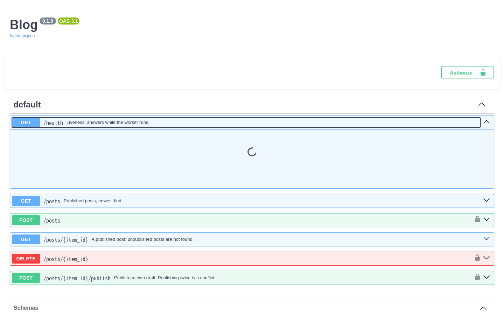
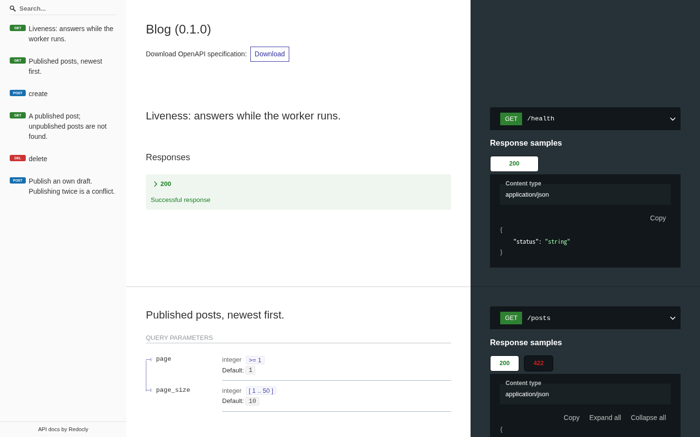
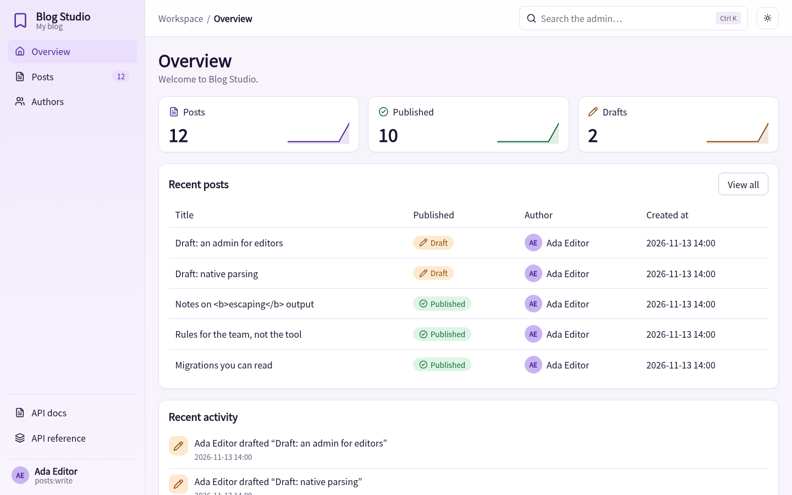
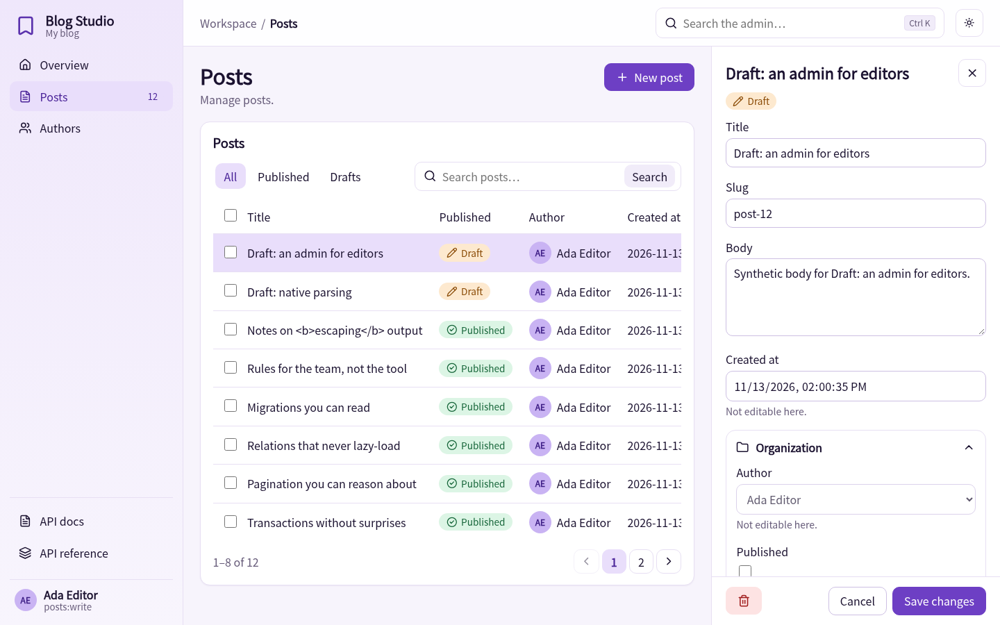
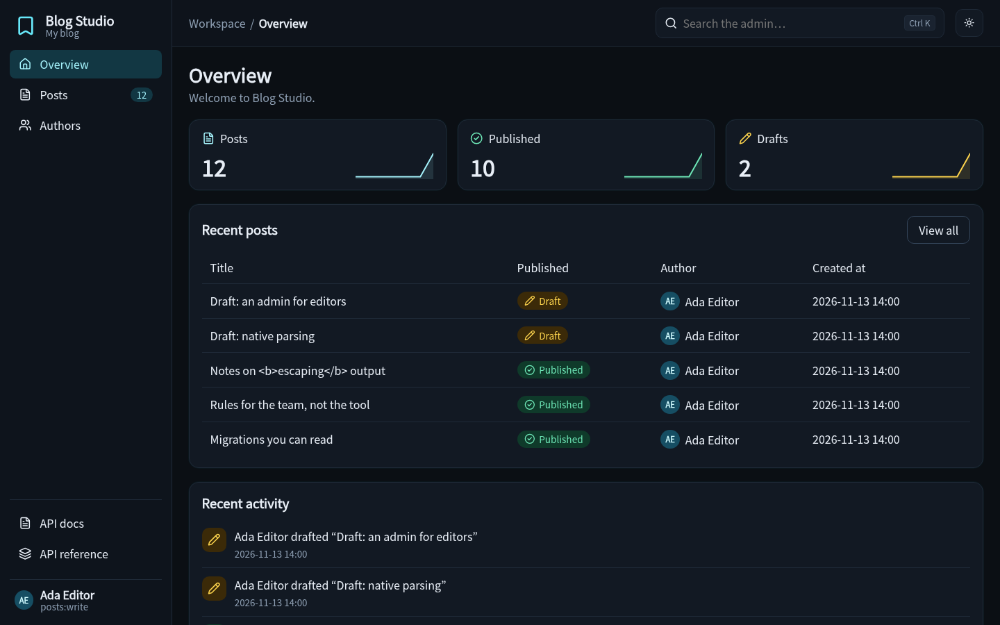
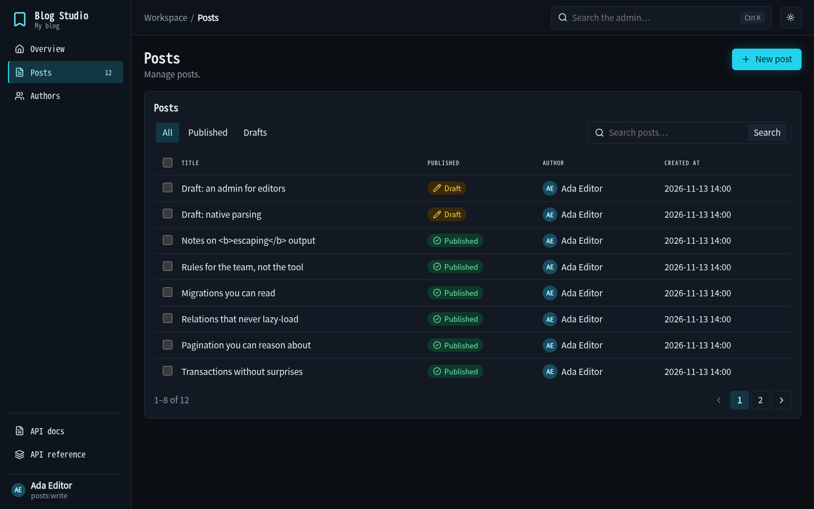
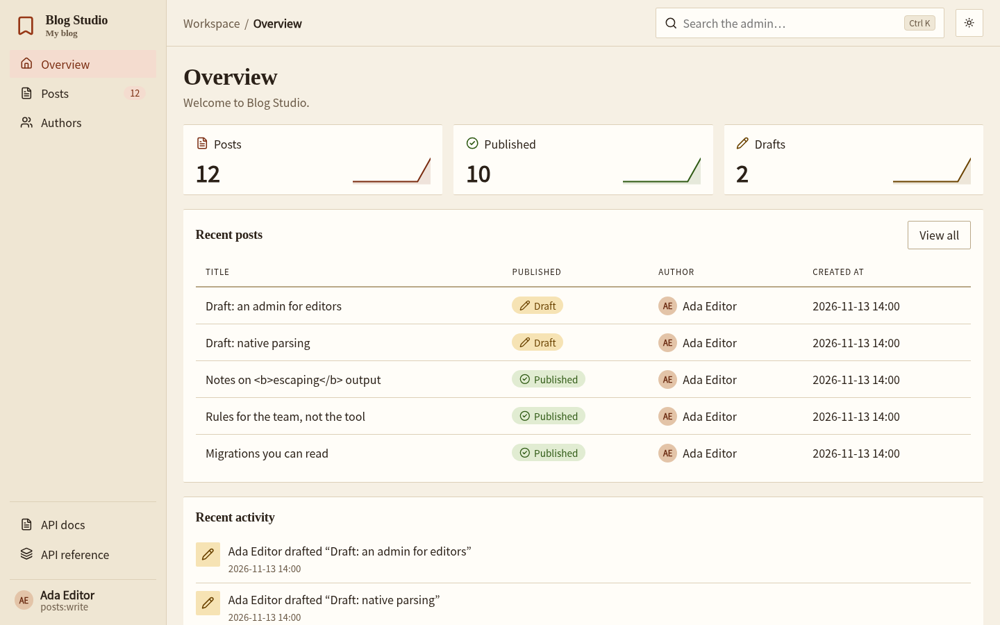
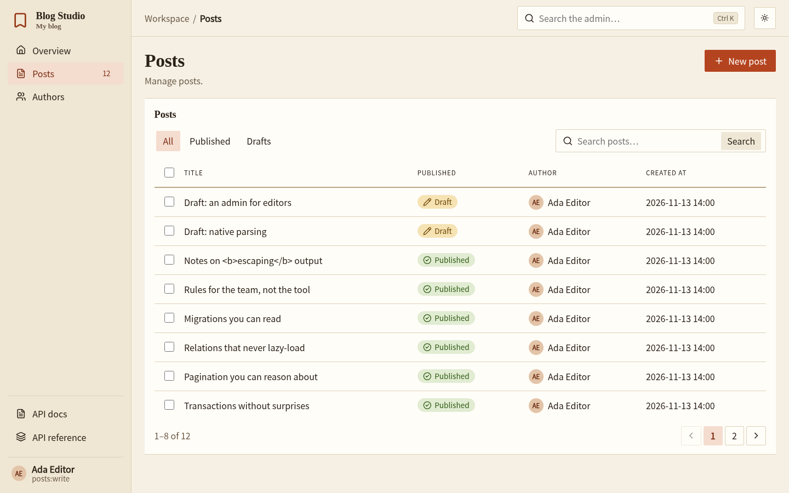
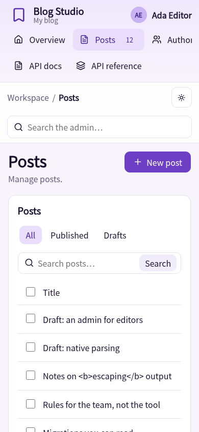

<p align="center">
  
</p>

<p align="center">
  <b>Typed Python APIs with a native Rust core.</b><br>
  Plain Python on the surface, verifiable architecture underneath.
</p>

<p align="center">
  <a href="https://github.com/caspel26/hinoki/actions/workflows/ci.yml"></a>
  
  
  
  <a href="LICENSE"></a>
</p>

---

> [!WARNING]
> **Hinoki is pre-alpha.** A reference blog runs end to end (HTTP server, validation,
> auth, ORM on PostgreSQL, transactions, pagination, OpenAPI), but APIs will change,
> and nothing is published to PyPI. See [What works today](#what-works-today).
> Do not build on it yet.

Hinoki is an independent framework for REST APIs and modular services. You write
ordinary, fully typed Python — functions or classes, sync or async — and Hinoki turns
those declarations into one registry that routing, validation, policies, OpenAPI and
development tooling all share. It is **not** built on Django, FastAPI, Starlette or
Pydantic.

Documentation site: `uv run --group docs mkdocs serve` (built strictly in CI; not published yet).

## Quick start

A whole API in one file ([`examples/notes/app.py`](examples/notes/app.py), tested end to end):

```python
class Note(Model, table="notes"):
    id: UUID = field(primary_key=True, default_factory=uuid4)
    title: str = field(max_length=80)
    body: str = ""


class NoteIn(Schema):
    title: Annotated[str, Field(min_length=1, max_length=80)]
    body: str = ""


class NoteOut(Schema):
    id: UUID
    title: str
    body: str


@get("/notes/{note_id}")
async def one(note_id: UUID) -> NoteOut:
    return NoteOut.from_model(await Note.aget(id=note_id))


@post("/notes", status=201, transaction=True)
async def create(data: NoteIn) -> NoteOut:
    return NoteOut.from_model(await Note.acreate(data))
```

`Note.acreate(data)` takes the validated `Schema` directly; extra keyword values (`acreate(data, author_id=me)`) are set by the server and always win over what the client sent. `NoteOut.from_model(row)` builds the response from a row, `row.aupdate_from(patch)` applies only the fields a client sent, and `data.to_dict()` gives the Python values. Validation and JSON serialisation of `Schema` classes run in Rust.

## The shape of the API

This is the confirmed target syntax ([`docs/`](docs) tracks what is implemented):

```python
from uuid import UUID

from hinoki import API, Access, HinokiAPI, Request, get, post
from hinoki.auth import Caller

editor = Access(auth=blog_auth, scopes={Scope.POSTS_WRITE})


@get("/health")
def health() -> HealthOut:
    return HealthOut(status="ok")


class Posts(API, path="/posts"):
    @get("/{post_id}")
    async def retrieve(self, post_id: UUID) -> PostOut:
        return PostOut.from_model(await Post.aget(id=post_id))

    @post("/", status=201, access=editor, transaction=True)
    async def create(
        self, data: PostCreate, principal: Caller[User]
    ) -> PostOut:
        ...


def create_app() -> HinokiAPI:
    app = HinokiAPI()
    app.include(health, Posts)
    return app
```

* **Plain Python.** `@get`/`@post`/`@put`/`@patch`/`@delete`, normal functions and classes,
  composable with your own decorators. No second grammar, no routing in docstrings.
* **The request, when you want it.** Path, query, body and principal values are typed
  parameters. Declare `request: Request` as the first parameter (after `self`) only when you
  need the Django-style `method`, `headers`, `GET`, `COOKIES`, `body`, `data` or `user`.
* **Honest types.** `-> PostOut` means the function returns a `PostOut`. Signatures survive
  decoration, so your IDE and type checker keep working.
* **Public by default, protected on purpose.** Policies are reusable `Access` objects named
  on the operation; declaring a provider protects nothing by itself.
* **Explicit transactions.** `transaction=True` on the action: rollback happens before
  the error becomes an HTTP response.
* **Declared, not discovered.** Importing a module registers no routes and opens no
  connection. Resources belong to modules with a lifespan.

## What makes it different (the goals)

| Goal | What it means |
| --- | --- |
| **Optional, deterministic rules** | Declare architectural boundaries; violations produce diagnostics with a stable ID, location and phase. Off unless you enable them. |
| **Real context for AI tooling** | A development MCP server exposes the live registry, `Schema` types and rule results — not a guess from reading files. |
| **Consistent customization** | Hand-written and generated (CRUD) operations share the same auth, errors and docs. Replace one operation without forking. |
| **Explicit modules** | Dependencies, resources and lifespan are inspectable; a module can grow into its own service. |
| **Native core** | Routing, request handling and the ORM engine in Rust; the Python/Rust boundary and its costs are documented, not hidden. |

Performance claims will appear only with reproducible benchmarks. There are none yet.

## What works today

Honest status, verified by the test suite:

| Area | State |
| --- | --- |
| Decorators `@get/@post/...`, `Access`, `API` classes, `HinokiAPI.include` / `install` | Implemented; typed and tested |
| Native router (`hinoki.native.Router`): `{param}` paths, literal-over-param priority with method-aware backtracking, 404/405 | Implemented in Rust |
| Modules: dependency graph, per-worker lifespan, reverse cleanup with per-step deadlines, managed tasks | Implemented; tested in-process and under Granian |
| ASGI adapter: raw-path routing, path/query/JSON-body binding, 400/401/403/404/405/409/415/422/503/504 mapping, bounded sync executor | Implemented |
| `Schema` / `Field` / `UNSET`: strict validation with capped, path-aware errors, nested and recursive schemas | Implemented (pure Python engine) |
| Auth: `BearerAuth` / `APIKeyAuth` / `HeaderAuth`, `Caller[T]`, scopes (401 vs 403), public by default | Implemented; **no JWT provider yet** |
| HTTP error hierarchy and `app.errors.handle(...)` | Implemented |
| OpenAPI 3.1 from the same declarations (`app.openapi()`, opt-in `openapi_url`), security schemes, pagination | Implemented; validated with `openapi-spec-validator`; no docs UI, examples or custom overrides yet |
| Pagination: `pagination=...` + `PageParams`, `Page[T]` | Implemented (page-number strategy only) |
| Database engine in Rust (`tokio-postgres` + `deadpool`): typed binary parameters, typed errors, transactions, cancellation-safe pooling | Implemented; PostgreSQL only |
| `transaction=True`: commit after output encoding, rollback before error translation, aborted commits reported as errors | Implemented and tested against PostgreSQL |
| SQL compiler in Rust (select/count/insert/update/delete, quoted identifiers, `$n` placeholders only) and Active Record `Model` / `QuerySet` | Implemented; foreign keys load only on request (`select_related` JOIN, `prefetch_related` one extra query); sync variants for sync handlers; generated CRUD (`CrudAPI` + `Resource`); many-to-many is an explicit join model with composite `unique=[...]`, no `through=` sugar |
| Versioned, inspectable SQL migrations planned from the models (`python -m hinoki migrations plan/apply/status/sql`); destructive operations refused unless allowed; never applied at startup | Implemented (PostgreSQL) |
| Reference blog (`examples/blog`) incl. a real Granian + PostgreSQL run | Implemented |
| Typing: constructors and decorators checked by `mypy --strict`; `Post(...)` and `await post.asave()` are checked; `Model.acreate(**values)` is **not** (generated stubs are still open) | Known gap ([docs/TYPING.md](docs/TYPING.md)) |
| Optional rules (`RuleSet`: access, transaction, schema exposure, static import boundaries), owner waivers, `python -m hinoki check` (text/JSON) | Implemented; runtime and scenario phases not built |
| Development MCP (`python -m hinoki mcp`): read-only project context over stdio | Implemented; not yet tested against a real MCP client; no application MCP |
| Interactive API docs: **Swagger UI** and **ReDoc** (`docs_url=`, `redoc_url=`), vendored and served from the package under a strict CSP | Implemented; verified in Chromium and Firefox |
| Admin extra (`hinoki.admin`): Studio/Midnight/Paper themes over one base component set, Lucide icons, dashboard stats, tabs, search, sortable paginated lists with badges and avatars, edit drawer or page, FK selects, fieldsets, bulk delete, signed CSRF, per-model `can()`/`queryset()`/`save()` hooks, template and CSS overrides | Implemented; reviewed once (findings fixed in this version). The earlier browser run covered the first version only: the new UI has been looked at in Chromium (screenshots above) but `tests/browser/verify.py` still targets the old markup and has **not** been re-run, and WebKit has never started here. No login UI, no rich-text or tag widgets, no audit log |
| `python -m hinoki new` scaffolds a project with rules on, `AGENTS.md` and the MCP configured; `explain_error` tool ([guide](docs/AI-WORKFLOW.md)) | Implemented; not yet exercised with a real MCP client or agent |
| JWT, benchmarks beyond micro-benchmarks | Not started |
| `Request` as the first handler argument (`method`, `headers`, `GET`, `COOKIES`, `body`, `data`, `user`) | Implemented; query, cookie and header parsing and JSON decode/encode run in Rust (modest measured gain for JSON, larger for query strings: [benchmarks](benchmarks/README.md)) |
| Body parsers chosen by `Content-Type`: JSON (default), form, multipart (Rust), custom; `parsers=[...]` per action | Implemented; uploads stay in memory within a 1 MiB body cap |
| Renderers chosen by `Accept` (negotiation in Rust, 406 before the handler runs), `renderers=[...]` per action, custom renderers | Implemented; error bodies are always JSON |

```python
>>> from hinoki import HinokiAPI, get
>>> @get("/users/{user_id}")
... def user(user_id: int) -> dict[str, int]:
...     return {"id": user_id}
>>> app = HinokiAPI(); app.include(user)
>>> route, params = app.resolve("GET", "/users/42")
>>> route.name, params
('user', {'user_id': '42'})
```

## A glance at the reference blog

```python
class Posts(API, path="/posts"):
    @get("/", pagination=PageNumberPagination(page_size=10, max_page_size=50))
    async def listing(self, page: PageParams) -> Page[PostOut]:
        newest = Post.filter(published=True).order_by("-created_at", "-id")
        return (await newest.apaginate(page)).map(to_out)

    @post("/", status=201, access=editor, transaction=True)
    async def create(
        self, data: PostCreate, principal: Caller[User]
    ) -> PostOut:
        created = await Post.acreate(data, author_id=principal.user.id)
        return to_out(created)
```

Full code in [`examples/blog`](examples/blog) (the real blog generates create and delete with `CrudAPI`; this handwritten form is what the generated action does). Create the tables with `python -m hinoki migrations --dir examples/blog/migrations apply --database $BLOG_DATABASE_URL`, then `BLOG_DATABASE_URL=… granian --interface asgi --factory examples.blog.main:create_app`.

## Screenshots

Taken from the reference blog (`examples/blog`) with real browsers (`tests/browser/verify.py`) against synthetic demo data.

| Swagger UI (`/docs`) | ReDoc (`/redoc`) |
| --- | --- |
|  |  |

The admin has three deliberately different themes built on one set of base components (Studio is the default; Midnight and Paper restyle the same pages through design tokens, fonts and a little CSS):

| Studio: dashboard | Studio: edit drawer |
| --- | --- |
|  |  |

| Midnight: dashboard | Midnight: list |
| --- | --- |
|  |  |

| Paper: dashboard | Paper: list |
| --- | --- |
|  |  |

| Studio on a phone (390 px) |
| --- |
|  |

Try it: create a disposable PostgreSQL database, then

```sh
export BLOG_DATABASE_URL=postgres://postgres:pw@127.0.0.1:5432/hinoki_demo
uv run python -m examples.blog.seed          # migrations + synthetic users and posts
uv run granian --interface asgi --factory examples.blog.main:create_app
# API docs:  http://127.0.0.1:8000/docs  and  /redoc
# Admin:     http://127.0.0.1:8000/admin  (send the cookie blog_token=demo-editor-token;
#            set BLOG_ADMIN_SECRET (32+ bytes) and optionally BLOG_ADMIN_THEME=studio|midnight|paper)
# Password login: set BLOG_JWT_SECRET (32+ bytes), then
#   curl -X POST :8000/auth/login -H 'content-type: application/json' \
#        -d '{"username":"ada","password":"demo-password-change-me"}'
#   -> a 15-minute JWT for GET /auth/me (Argon2id hashing and JWT signing run in Rust)
```

## Core concepts

How the pieces fit and what to avoid: [`docs/PATTERNS.md`](docs/PATTERNS.md). Building with an AI agent: [`docs/AI-WORKFLOW.md`](docs/AI-WORKFLOW.md).

* **`Request`** is the incoming HTTP request, passed to an action that declares it as its first parameter (`method`, `headers`, `GET`, `COOKIES`, `body`, `data`, `user`). Path, query and body values follow as typed parameters.
* **`Caller`** (also spelled `Principal`) is *who is making the request*, as decided by authentication. An auth provider (bearer token, API key, JWT, a cookie) turns the credentials into a `Caller` with three things: `id` (a stable string), `user` (your own object, for example the `User` row) and `permissions` (what it may do). Declare `caller: Caller[User]` on an action to receive it; `request.user` is the same object. No valid credentials: the request is refused before your code runs (401); missing permissions: 403. (`Principal`, `subject`, `identity`, `scopes` and `Access(scopes=...)` remain as aliases of the same things.)
* **`Access`** is a reusable policy: *which provider* authenticates and *which permissions* are required: `Access(auth=tokens, permissions=["posts:write"])`. You attach it to an action with `access=editor`; an action without one is public.
* **`Schema`** describes data that crosses the API boundary (request bodies and responses) and validates it strictly; **`Model`** describes a database table. They are separate on purpose, so a column never leaks into a response unless a schema names it (rules can enforce that).
* **Settings** are typed, immutable and loaded explicitly: `class BlogSettings(FrameworkSettings): jwt_secret: Secret; ...`, then `BlogSettings.load(prefix="BLOG_", dotenv=".env")` and `HinokiAPI(settings=settings)`. Built-in groups (`execution`, `lifecycle`, `logging`, `docs`) are set with variables such as `BLOG_EXECUTION__SYNC_WORKERS=16` or `BLOG_LOGGING__FORMAT=json`; secrets never print; a typo in a variable name or a bad value fails at startup with every problem listed ([`docs/SETTINGS.md`](docs/SETTINGS.md); `python -m hinoki settings` shows where every value comes from).
* **`Reply`** lets an action choose the status, headers or body itself (redirects, cookies, HTML) instead of returning a value to be rendered.

## Rules: architecture you can check

Optional, typed rules turn architectural promises into failures with a stable ID and a location. The blog enables four (`examples/blog/rules.py`); they run when the app starts and from the command line:

```text
$ python -m hinoki check --app examples.blog.main:create_app --rules examples.blog.rules:blog_rules --package examples
4 rule(s): 0 violated, 0 unverifiable, 0 waived

$ python -m hinoki check --app tests.projects.rulesapp:create_app --rules tests.projects.rulesapp:rules
tests/projects/rulesapp.py:7: HNK-ACC-001 [violated] GET /health (health) declares no access policy
tests/projects/rulesapp.py:12: HNK-ACC-001 [violated] POST /items (create) declares no access policy
tests/projects/rulesapp.py:12: HNK-TXN-001 [violated] POST /items (create) does not declare transaction=True
2 rule(s): 3 violated, 0 unverifiable, 0 waived
```

Exceptions are owner-declared waivers with a reason and a bounded target; tools and agents read them and never edit them. Full guide: [`docs/RULES.md`](docs/RULES.md).

## Architecture

```
 client ─▶ Granian (Rust: hyper/tokio) ─▶ hinoki ASGI adapter (Python, thin)
                                              │
                                              ▼
                              hinoki.native (Rust, PyO3)
                              router · limits · (next) request decoding
                                              │
                                              ▼
                  registry ─▶ pipeline: auth → transaction → handler → output check
                                              │
                                              ▼
                              ORM engine (Rust): query AST → SQL → pool
```

The ASGI path crosses Python objects and is documented as such. Read
[`docs/RUNTIME-DESIGN.md`](docs/RUNTIME-DESIGN.md) for the exact boundary, resource
ownership per worker, the bounded sync executor and the lifespan/shutdown sequence, and
[`docs/adr/`](docs/adr) for the decisions and rejected alternatives.

## Roadmap

1. ~~**Runtime** — lifespan coordinator, ASGI adapter, bounded sync executor~~ ✅
2. ~~**Vertical slice: blog** — request → schema → ORM (PostgreSQL) → auth → rollback → OpenAPI → pagination~~ ✅
3. ~~**ORM and generated CRUD** — relations, eager loading, migrations, replaceable CRUD operations~~ ✅ (JWT still open)
4. **Request object, parsers and renderers** — `request` as an optional first argument ✅; Rust parsing, parsers, renderers next
5. ~~**Rules and development MCP**~~ ✅ (client compatibility unverified)
6. **Admin extra** — first slice done (Classic theme, overrides); login, relations, more themes, review pending
7. **Stabilization** — wheels, benchmarks, release policy

The working queue lives in [`handoff.md`](handoff.md).

## Development

```sh
uv sync --locked                      # venv + builds the Rust extension via maturin
uv run --locked pytest --cov          # Python tests (DB tests need HINOKI_TEST_DATABASE_URL)
uv run --locked mypy                  # strict types + typing fixtures
uv run --locked ruff check . && uv run --locked ruff format --check .
cargo test --workspace                # Rust tests
```

Requirements: [uv](https://docs.astral.sh/uv/), a stable Rust toolchain, Python 3.12+.
Full gate list: [`docs/TOOLCHAIN.md`](docs/TOOLCHAIN.md) · Contributing:
[`CONTRIBUTING.md`](CONTRIBUTING.md) · Agent rules: [`AGENTS.md`](AGENTS.md).

## License

[MIT](LICENSE) © 2026 Caspel26
