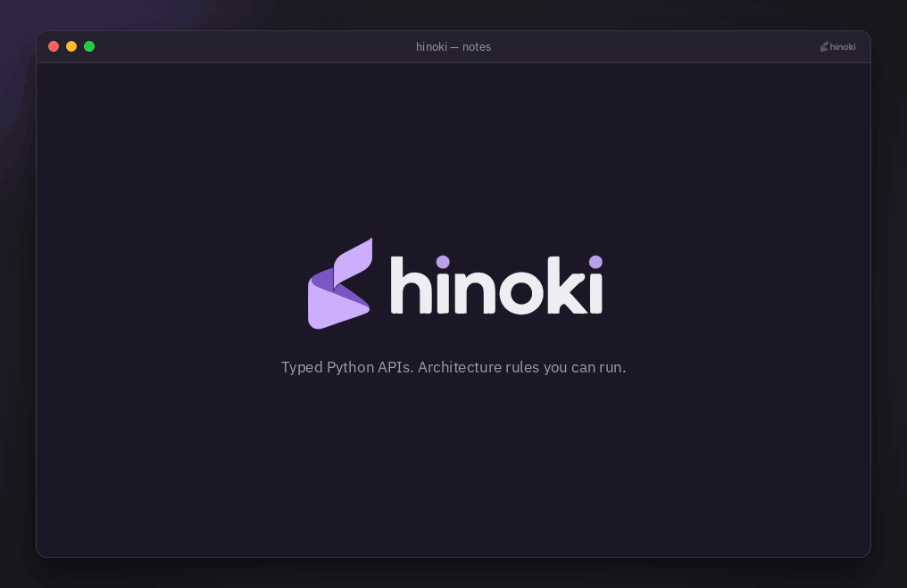
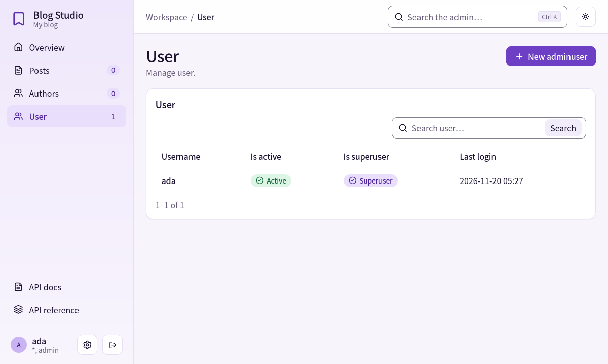

<p align="center">
  <a href="https://caspel26.github.io/hinoki/">
    <picture>
      <source media="(prefers-color-scheme: dark)" srcset="assets/readme/lockup-dark.svg">
      
    </picture>
  </a>
</p>

<p align="center">
  <strong>Typed Python APIs. Architecture rules you can run.</strong><br>
  <sub>A Python framework for HTTP APIs, with a Rust core.</sub>
</p>

<p align="center">
  <a href="https://github.com/caspel26/hinoki/actions/workflows/ci.yml"></a>
  <a href="https://codecov.io/gh/caspel26/hinoki"></a>
  
  <a href="https://caspel26.github.io/hinoki/dev/status/"></a>
  <a href="LICENSE"></a>
</p>

<p align="center">
  <a href="https://caspel26.github.io/hinoki/dev/">Documentation</a> ·
  <a href="https://caspel26.github.io/hinoki/dev/quick-start/">Quick start</a> ·
  <a href="https://caspel26.github.io/hinoki/dev/tutorial/">Tutorial</a> ·
  <a href="examples">Examples</a> ·
  <a href="https://caspel26.github.io/hinoki/dev/status/">Status</a>
</p>

<p align="center">
  <picture>
    <source media="(prefers-reduced-motion: reduce)" srcset="assets/readme/demo.png">
    
  </picture>
</p>
<p align="center"><sub>Real terminal output recorded by <a href="scripts/readme_demo.py"><code>scripts/readme_demo.py</code></a>; waits are shortened.</sub></p>

> [!WARNING]
> **Pre-alpha, not released.** The API and the migration format may change. The [`hinoki` package on PyPI](https://pypi.org/project/hinoki/) is an unrelated project: install Hinoki from this repository and use disposable data.

## Start a project

You need [uv](https://docs.astral.sh/uv/) and a stable Rust toolchain; the native extension builds from source.

```sh
git clone https://github.com/caspel26/hinoki
cd hinoki
uv sync --locked
uv run hinoki new   # asks for the name, parent directory (..), database and server
cd ../notes         # the name you chose
uv run hinoki dev   # API docs at http://127.0.0.1:8000/docs
uv run hinoki check # runs the project's rules
uv run pytest
```

`hinoki.toml` names the application, its routes, models and migrations, so commands inside a project take no target. The [Quick start](docs/quick-start.md) walks through the prompts.

## Write an API

A model, then a group of actions that share a path, an access policy and a transaction, beside the generated `health` endpoint:

```python
# notes/models.py
from uuid import UUID, uuid4

from hinoki.orm import Model, field, pk


class Note(Model):
    id: UUID = pk(default_factory=uuid4)
    title: str = field(max_length=80)
    body: str = ""
```

```python
# notes/api.py
from typing import Annotated

from hinoki import Field, RouteGroup, Schema, derive, http
from hinoki.pagination import Page, PageNumberPagination, PageParams

from notes.models import Note
from notes.security import editors


class Health(Schema):
    status: str


@http.get("/health")
def health() -> Health:
    return Health(status="ok")


class NoteIn(Schema):
    title: Annotated[str, Field(min_length=1, max_length=80)]
    body: Annotated[str, Field(max_length=2000)] = ""


@derive(Note)
class NoteOut(Schema): ...


note_routes = RouteGroup("/notes", access=editors, atomic=True)


@note_routes.get("/", pagination=PageNumberPagination(page_size=20))
async def list_notes(page: PageParams) -> Page[NoteOut]:
    return (await Note.all().apaginate(page)).map(NoteOut.from_model)


@note_routes.post("/", status=201)
async def create_note(data: NoteIn) -> NoteOut:
    return NoteOut.from_model(await Note.acreate(data))
```

`editors` is an `Access` policy: a token check and the permissions it requires ([Authentication](docs/authentication.md)). List the group in `notes/routes.py` (`routes = [health, note_routes]`); `main.py` does not change. Input is validated before the handler runs and a response contains only its declared fields. Tables change only through reviewed SQL: `uv run hinoki migrations plan` writes the migration, `uv run hinoki migrations apply` runs it.

## What you get

- **Declared contracts.** `Schema` input and output, access policies, `atomic` writes and declared errors drive validation, the OpenAPI document and the test client.
- **Rules you can run.** `hinoki check` has eleven built-in rules: access, permissions, return types, pagination, transactions, model responses, exposed fields, string limits, pinned tables, foreign-key indexes and import direction. A new project turns on eight. Each finding names a file, a line and a fix; a waiver needs an owner and a reason.
- **ORM and migrations.** SQLite, PostgreSQL, MySQL and MariaDB, explicit relation loading, and SQL migration files you review. Importing an app never connects to a database.
- **Tools.** Typed settings, generated CRUD, a CLI, MCP servers for the application and for development, and an optional admin.

## Admin

The optional admin is mounted explicitly. By default it has its own users, a sign-in page and per-model permissions; it can use your application's access policy instead. It has four themes, each with light and dark modes. See the [admin guide](docs/admin.md).

<p align="center">
  <picture>
    <source media="(prefers-color-scheme: dark)" srcset="assets/readme/admin-login-dark.png">
    
  </picture>
  <picture>
    <source media="(prefers-color-scheme: dark)" srcset="assets/readme/admin-users-dark.png">
    
  </picture>
</p>

## Python and Rust

`hinoki dev` and `hinoki serve` run on Kiso, Hinoki's HTTP server written in Rust; `--server granian` runs Granian instead. Path matching, selected request parsing, schema validation and serialization, and ORM SQL compilation and execution run in the extension. The ASGI adapter, handlers and most of the request pipeline run in Python; on Kiso, an `async def` handler that only awaits ORM calls is driven from Rust. [Serving](docs/serving.md) documents the boundary.

## Status

Pre-alpha, tested in CI on Linux with Python 3.12–3.14. The [status page](https://caspel26.github.io/hinoki/dev/status/) lists what is not available yet. The [benchmark report](docs/benchmarks.md) describes retained runs and their limits; it is not a general ranking.

<p align="center">
  <a href="https://caspel26.github.io/hinoki/dev/guides/">Guides</a> ·
  <a href="https://caspel26.github.io/hinoki/dev/reference/">Reference</a> ·
  <a href="examples">Examples</a> ·
  <a href="ROADMAP.md">Roadmap</a> ·
  <a href="CONTRIBUTING.md">Contributing</a> ·
  <a href="LICENSE">MIT license</a>
</p>
