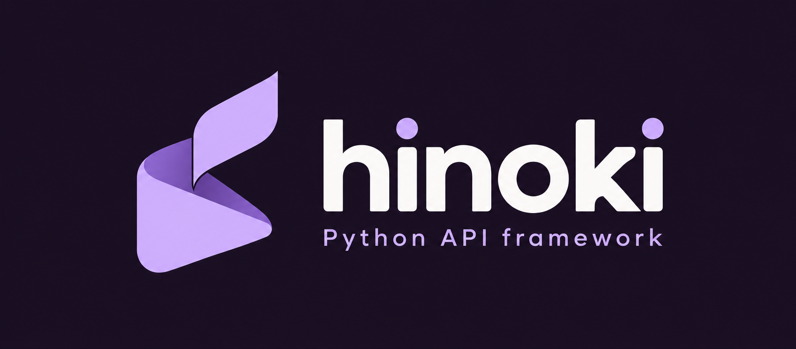

<p align="center">
  
</p>

<p align="center">
  <b>Typed Python APIs with a native Rust core.</b><br>
  Plain Python on the surface, verifiable architecture underneath.
</p>

<p align="center">
  <a href="https://github.com/caspel26/hinoki/actions/workflows/ci.yml"></a>
  
  
  
  <a href="LICENSE"></a>
</p>

---

> [!WARNING]
> **Hinoki is pre-alpha.** A reference blog runs end to end (HTTP server, validation,
> auth, ORM on PostgreSQL, transactions, pagination, OpenAPI), but APIs will change,
> and nothing is published to PyPI. See [What works today](#what-works-today).
> Do not build on it yet.

Hinoki is an independent framework for REST APIs and modular services. You write
ordinary, fully typed Python — functions or classes, sync or async — and Hinoki turns
those declarations into one registry that routing, validation, policies, OpenAPI and
development tooling all share. It is **not** built on Django, FastAPI, Starlette or
Pydantic.

## The shape of the API

This is the confirmed target syntax ([`docs/`](docs) tracks what is implemented):

```python
from uuid import UUID

from hinoki import API, Access, HinokiAPI, get, post
from hinoki.auth import Principal

editor = Access(auth=blog_auth, scopes={Scope.POSTS_WRITE})


@get("/health")
def health() -> HealthOut:
    return HealthOut(status="ok")


class Posts(API, path="/posts"):
    @get("/{post_id}")
    async def retrieve(self, post_id: UUID) -> PostOut:
        return PostOut.from_model(await Post.aget(id=post_id))

    @post("/", status=201, access=editor, transaction=True)
    async def create(self, data: PostCreate, principal: Principal[User]) -> PostOut:
        ...


def create_app() -> HinokiAPI:
    app = HinokiAPI()
    app.include(health, Posts)
    return app
```

* **Plain Python.** `@get`/`@post`/`@put`/`@patch`/`@delete`, normal functions and classes,
  composable with your own decorators. No second grammar, no routing in docstrings.
* **Honest types.** `-> PostOut` means the function returns a `PostOut`. Signatures survive
  decoration, so your IDE and type checker keep working.
* **Public by default, protected on purpose.** Policies are reusable `Access` objects named
  on the operation; declaring a provider protects nothing by itself.
* **Explicit transactions.** `transaction=True` on the action: rollback happens before
  the error becomes an HTTP response.
* **Declared, not discovered.** Importing a module registers no routes and opens no
  connection. Resources belong to modules with a lifespan.

## What makes it different (the goals)

| Goal | What it means |
| --- | --- |
| **Optional, deterministic rules** | Declare architectural boundaries; violations produce diagnostics with a stable ID, location and phase. Off unless you enable them. |
| **Real context for AI tooling** | A development MCP server exposes the live registry, schemas and rule results — not a guess from reading files. |
| **Consistent customization** | Hand-written and generated (CRUD) operations share the same auth, errors and docs. Replace one operation without forking. |
| **Explicit modules** | Dependencies, resources and lifespan are inspectable; a module can grow into its own service. |
| **Native core** | Routing, request handling and the ORM engine in Rust; the Python/Rust boundary and its costs are documented, not hidden. |

Performance claims will appear only with reproducible benchmarks. There are none yet.

## What works today

Honest status, verified by the test suite:

| Area | State |
| --- | --- |
| Decorators `@get/@post/...`, `Access`, `API` classes, `HinokiAPI.include` / `install` | Implemented; typed and tested |
| Native router (`hinoki.native.Router`): `{param}` paths, literal-over-param priority with method-aware backtracking, 404/405 | Implemented in Rust |
| Modules: dependency graph, per-worker lifespan, reverse cleanup with per-step deadlines, managed tasks | Implemented; tested in-process and under Granian |
| ASGI adapter: raw-path routing, path/query/JSON-body binding, 400/401/403/404/405/409/415/422/503/504 mapping, bounded sync executor | Implemented |
| `Schema` / `Field` / `UNSET`: strict validation with capped, path-aware errors, nested and recursive schemas | Implemented (pure Python engine) |
| Auth: `BearerAuth` / `APIKeyAuth` / `HeaderAuth`, `Principal[T]`, scopes (401 vs 403), public by default | Implemented; **no JWT provider yet** |
| HTTP error hierarchy and `app.errors.handle(...)` | Implemented |
| OpenAPI 3.1 from the same declarations (`app.openapi()`, opt-in `openapi_url`), security schemes, pagination | Implemented; validated with `openapi-spec-validator`; no docs UI, examples or custom overrides yet |
| Pagination: `pagination=...` + `PageParams`, `Page[T]` | Implemented (page-number strategy only) |
| Database engine in Rust (`tokio-postgres` + `deadpool`): typed binary parameters, typed errors, transactions, cancellation-safe pooling | Implemented; PostgreSQL only |
| `transaction=True`: commit after output encoding, rollback before error translation, aborted commits reported as errors | Implemented and tested against PostgreSQL |
| SQL compiler in Rust (select/count/insert/update/delete, quoted identifiers, `$n` placeholders only) and Active Record `Model` / `QuerySet` | Implemented; foreign keys load only on request (`select_related` JOIN, `prefetch_related` one extra query); sync variants for sync handlers; generated CRUD (`CrudAPI` + `Resource`); many-to-many is an explicit join model with composite `unique=[...]`, no `through=` sugar |
| Versioned, inspectable SQL migrations planned from the models (`python -m hinoki migrations plan/apply/status/sql`); destructive operations refused unless allowed; never applied at startup | Implemented (PostgreSQL) |
| Reference blog (`examples/blog`) incl. a real Granian + PostgreSQL run | Implemented |
| Typing: constructors and decorators checked by `mypy --strict`; `Post(...)` and `await post.asave()` are checked; `Model.acreate(**values)` is **not** (generated stubs are still open) | Known gap ([docs/TYPING.md](docs/TYPING.md)) |
| JWT, rules engine, MCP, admin extra, benchmarks beyond the router micro-benchmark | Not started |
| Django-style `Request` as first handler argument, pluggable parsers and renderers in Rust | Designed ([docs/REQUEST-DESIGN.md](docs/REQUEST-DESIGN.md)), not implemented; the handler shape above will change |

```python
>>> from hinoki import HinokiAPI, get
>>> @get("/users/{user_id}")
... def user(user_id: int) -> dict[str, int]:
...     return {"id": user_id}
>>> app = HinokiAPI(); app.include(user)
>>> route, params = app.resolve("GET", "/users/42")
>>> route.name, params
('user', {'user_id': '42'})
```

## A glance at the reference blog

```python
class Posts(API, path="/posts"):
    @get("/", pagination=PageNumberPagination(page_size=10, max_page_size=50))
    async def listing(self, page: PageParams) -> Page[PostOut]:
        newest = Post.filter(published=True).order_by("-created_at", "-id")
        return (await newest.apaginate(page)).map(to_out)

    @post("/", status=201, access=editor, transaction=True)
    async def create(self, data: PostCreate, principal: Principal[User]) -> PostOut:
        created = await Post.acreate(
            author_id=principal.identity.id,
            title=data.title,
            slug=data.slug,
            body=data.body,
        )
        return to_out(created)
```

Full code in [`examples/blog`](examples/blog). Create the schema with `python -m hinoki migrations --dir examples/blog/migrations apply --database $BLOG_DATABASE_URL`, then `BLOG_DATABASE_URL=… granian --interface asgi --factory examples.blog.main:create_app`.

## Architecture

```
 client ─▶ Granian (Rust: hyper/tokio) ─▶ hinoki ASGI adapter (Python, thin)
                                              │
                                              ▼
                              hinoki.native (Rust, PyO3)
                              router · limits · (next) request decoding
                                              │
                                              ▼
                  registry ─▶ pipeline: auth → transaction → handler → output check
                                              │
                                              ▼
                              ORM engine (Rust): query AST → SQL → pool
```

The ASGI path crosses Python objects and is documented as such. Read
[`docs/RUNTIME-DESIGN.md`](docs/RUNTIME-DESIGN.md) for the exact boundary, resource
ownership per worker, the bounded sync executor and the lifespan/shutdown sequence, and
[`docs/adr/`](docs/adr) for the decisions and rejected alternatives.

## Roadmap

1. ~~**Runtime** — lifespan coordinator, ASGI adapter, bounded sync executor~~ ✅
2. ~~**Vertical slice: blog** — request → schema → ORM (PostgreSQL) → auth → rollback → OpenAPI → pagination~~ ✅
3. ~~**ORM and generated CRUD** — relations, eager loading, migrations, replaceable CRUD operations~~ ✅ (JWT still open)
4. **Request object, parsers and renderers** — `request` as first argument, Rust parsing and rendering
5. **Rules and development MCP**
6. **Admin extra** — one theme, full HTML override
7. **Stabilization** — wheels, benchmarks, release policy

The working queue lives in [`handoff.md`](handoff.md).

## Development

```sh
uv sync --locked                      # venv + builds the Rust extension via maturin
uv run --locked pytest --cov          # Python tests (DB tests need HINOKI_TEST_DATABASE_URL)
uv run --locked mypy                  # strict types + typing fixtures
uv run --locked ruff check . && uv run --locked ruff format --check .
cargo test --workspace                # Rust tests
```

Requirements: [uv](https://docs.astral.sh/uv/), a stable Rust toolchain, Python 3.12+.
Full gate list: [`docs/TOOLCHAIN.md`](docs/TOOLCHAIN.md) · Contributing:
[`CONTRIBUTING.md`](CONTRIBUTING.md) · Agent rules: [`AGENTS.md`](AGENTS.md).

## License

[MIT](LICENSE) © 2026 Caspel26
