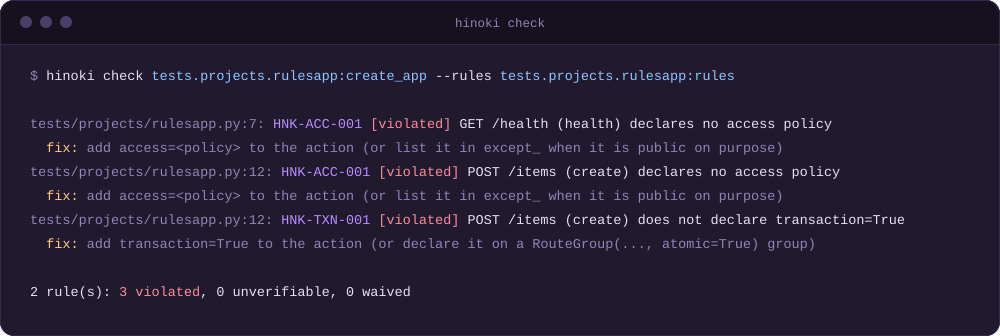

<p align="center">
  <a href="https://caspel26.github.io/hinoki/">
    <picture>
      <source media="(prefers-color-scheme: dark)" srcset="assets/readme/lockup-dark.svg">
      <source media="(prefers-color-scheme: light)" srcset="assets/readme/lockup-light.svg">
      
    </picture>
  </a>
</p>

<h3 align="center">Python APIs with architecture you can check.</h3>

<p align="center">
  Typed endpoints, declared access and transactions, a SQLite, PostgreSQL, MySQL and MariaDB ORM,<br>
  and optional architecture rules that report violations and fail CI.
</p>

<p align="center">
  <a href="https://caspel26.github.io/hinoki/"><strong>Documentation</strong></a> &nbsp;·&nbsp;
  <a href="https://caspel26.github.io/hinoki/dev/quick-start/">Quick start</a> &nbsp;·&nbsp;
  <a href="https://caspel26.github.io/hinoki/dev/tutorial/">Tutorial</a> &nbsp;·&nbsp;
  <a href="examples">Examples</a> &nbsp;·&nbsp;
  <a href="https://caspel26.github.io/hinoki/dev/status/">Status</a>
</p>

<p align="center">
  <a href="https://github.com/caspel26/hinoki/actions/workflows/ci.yml"></a>
  <a href="https://codecov.io/gh/caspel26/hinoki"></a>
  
  <a href="https://caspel26.github.io/hinoki/dev/status/"></a>
  <a href="LICENSE"></a>
</p>

<p align="center">
  
</p>

> [!WARNING]
> **Pre-alpha.** The API and migration format may change. This repository's Hinoki is not published on PyPI; the [`hinoki` name there belongs to an unrelated legacy package](https://pypi.org/project/hinoki/). Install from this source checkout to evaluate it, use disposable data, and do not run it in production.

## What Hinoki is

A Python framework for HTTP APIs built on three ideas:

- **Declare.** An endpoint states its types, who may call it, whether it runs in a transaction and which errors it returns. That one declaration drives validation, responses and the OpenAPI document.
- **Check.** Optional rules, such as "every write runs in a transaction" or "models never import the API layer", are verified by `hinoki check`, which reports file, line and fix and fails CI.
- **Run.** ASGI under Granian, or the opt-in Rust HTTP server. The Rust extension handles path matching, selected query/header/cookie parsing, schema validation and serialization, cryptography and SQL ORM compilation/execution; application handlers stay ordinary Python, sync or async.

## A small API

Condensed from the [Notes example](examples/notes) (model in `models.py`, schemas and endpoints in `app.py`):

```python
from typing import Annotated
from uuid import UUID, uuid4

from hinoki import Field, Schema, http
from hinoki.orm import Model, field


class Note(Model):  # table "notes", derived from the class name
    id: UUID = field(primary_key=True, default_factory=uuid4)
    title: str = field(max_length=80)
    body: str = ""


class NoteIn(Schema):
    title: Annotated[str, Field(min_length=1, max_length=80)]
    body: str = ""


class NoteOut(Schema):
    id: UUID
    title: str
    body: str


@http.post("/notes", status=201, transaction=True)
async def create(data: NoteIn) -> NoteOut:
    return NoteOut.from_model(await Note.acreate(data))
```

Only what a `Schema` names leaves the application. An invalid body is refused before the handler runs:

```json
{"error":"validation_error","request_id":"…","details":[{"path":"data.title","code":"min_length","message":"at least 1 long"}]}
```

## Try it

You need [uv](https://docs.astral.sh/uv/) and a Rust toolchain; the core builds from source.

```sh
git clone https://github.com/caspel26/hinoki && cd hinoki
uv sync --locked
cd examples
uv run --project .. hinoki migrations sql --app notes 0001-create-table-notes  # review it
uv run --project .. hinoki migrations apply --app notes  # local SQLite by default
uv run --project .. hinoki dev notes.main:app
```

Swagger UI is at `http://127.0.0.1:8000/docs`. Hinoki never creates tables by itself: migrations are files you review and apply. `hinoki new NAME` scaffolds your own project. The [quick start](https://caspel26.github.io/hinoki/dev/quick-start/) explains each step and the [tutorial](https://caspel26.github.io/hinoki/dev/tutorial/) builds a larger app.

## Rules you can run

The [Tracker example](examples/tracker) states its architecture as rules ([`rules.py`](examples/tracker/rules.py)):

```python
from hinoki import Actions, Imports, Schemas, Transactions
from hinoki.rules import RuleSet

tracker_rules = RuleSet(
    Actions.require_access(match="tracker.*", except_=["tracker.api.health"]),
    Transactions.require_atomic(except_=["hinoki.mcpapp.*"]),
    Schemas.forbid_exposure("token"),
    Imports.forbid(source="tracker.models", target="tracker.api"),
    ...
)
```

```sh
uv run --project .. hinoki check tracker.app:create_app --rules tracker.rules:tracker_rules --package tracker
# 7 rule(s): 0 violated, 0 unverifiable, 0 waived
```

The check reads the application and its source without connecting to a database. Rules are optional. See the [rules guide](https://caspel26.github.io/hinoki/dev/rules/).

## What is in the box

| | |
| --- | --- |
| **Endpoints** | `@http.get/post/put/patch/delete/query` on functions, route groups or classes; typed path, query, body and file parameters; optional generated CRUD |
| **Data** | Strict `Schema` validation and model-derived schemas; an ORM for SQLite, PostgreSQL, MySQL and MariaDB with relations, eager loading, transactions and reviewed migration files |
| **Access** | Reusable access policies with permissions; declared errors in OpenAPI |
| **Runtime** | Typed settings from environment, files or TOML; per-worker modules with startup and shutdown |
| **Tools** | OpenAPI 3.1 with Swagger UI and ReDoc, test clients, project scaffold, MCP servers for apps and coding agents, an optional [admin](examples/blog) |

## Status and limits

Pre-alpha, no release; tested in CI on Python 3.12–3.14 on Linux. Not yet available: SQL Server and Oracle, streaming responses and WebSockets, cursor pagination. CORS is one application-wide policy. The full list is on the [status page](https://caspel26.github.io/hinoki/dev/status/), and measured comparisons with their method and limits are on the [benchmarks page](https://caspel26.github.io/hinoki/dev/benchmarks/).

## Documentation

[Guides](https://caspel26.github.io/hinoki/dev/guides/) · [Reference](https://caspel26.github.io/hinoki/dev/reference/) · [Examples](examples) · [Contributing](CONTRIBUTING.md)
