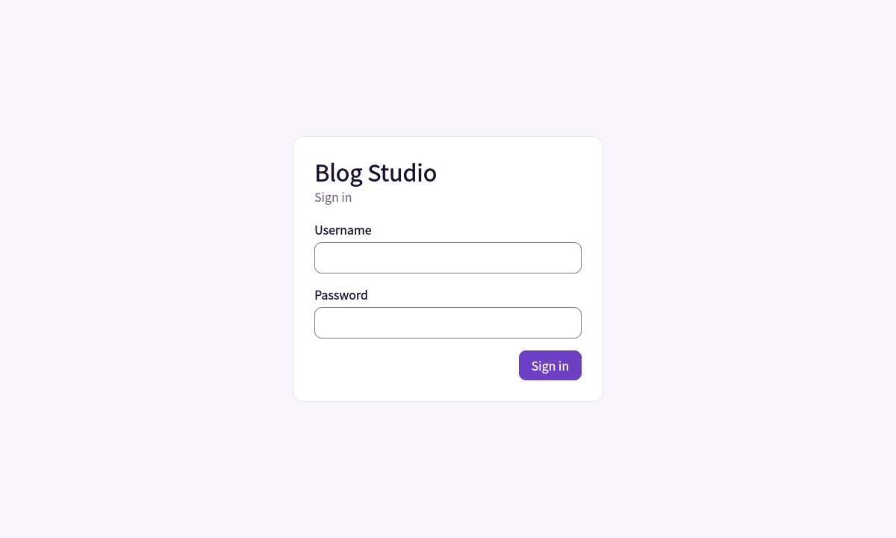

<p align="center">
  <a href="https://hinoki.caspel.dev/">
    <picture>
      <source media="(prefers-color-scheme: dark)" srcset="assets/readme/lockup-dark.svg">
      
    </picture>
  </a>
</p>

<p align="center">
  <strong>Typed Python APIs. Architecture rules you can run.</strong><br>
  <sub>A Python framework for HTTP APIs, with a Rust core and its own Rust server, Kiso.</sub>
</p>

<p align="center">
  <a href="https://github.com/caspel26/hinoki/actions/workflows/ci.yml"></a>
  <a href="https://codecov.io/gh/caspel26/hinoki"></a>
  <a href="https://sonarcloud.io/project/overview?id=caspel26_hinoki"></a>
  <a href="https://github.com/caspel26/hinoki/actions/workflows/codeql.yml"></a>
  <a href="https://scorecard.dev/viewer/?uri=github.com/caspel26/hinoki"></a>
  <a href="https://www.bestpractices.dev/projects/16941"></a>
  
  <a href="https://hinoki.caspel.dev/dev/status/"></a>
  <a href="LICENSE"></a>
</p>

<p align="center">
  <a href="https://hinoki.caspel.dev/dev/">Documentation</a> ·
  <a href="https://hinoki.caspel.dev/dev/quick-start/">Quick start</a> ·
  <a href="https://hinoki.caspel.dev/dev/tutorial/">Tutorial</a> ·
  <a href="examples">Examples</a> ·
  <a href="https://hinoki.caspel.dev/dev/status/">Status</a>
</p>

<p align="center">
  <picture>
    <source media="(prefers-reduced-motion: reduce)" srcset="assets/readme/demo.png">
    
  </picture>
</p>
<p align="center"><sub>Real terminal output recorded by <a href="scripts/readme_demo.py"><code>scripts/readme_demo.py</code></a>; waits are shortened, and the posts app's source files and migrations are written off screen.</sub></p>

> [!WARNING]
> **Pre-alpha, not released.** The API and the migration format may change. The [`hinoki` package on PyPI](https://pypi.org/project/hinoki/) is an unrelated project: install Hinoki from this repository and use disposable data.

Hinoki is a Python framework for typed HTTP APIs with a Rust core. Apps run on **Kiso**, Hinoki's own HTTP server, written in Rust on hyper, tokio and rustls: `hinoki dev` and `hinoki serve` use it by default, and `--server granian` runs [Granian](https://github.com/emmett-framework/granian) instead. You declare schemas, access policies and `atomic` writes in plain Python; `hinoki check` turns architecture rules into findings with a file, a line and a fix.

<p align="center">
  <a href="#how-it-works">How it works</a> ·
  <a href="#quick-start">Quick start</a> ·
  <a href="#write-an-api">Write an API</a> ·
  <a href="#what-you-get">What you get</a> ·
  <a href="#interactive-api-docs">API docs</a> ·
  <a href="#admin">Admin</a> ·
  <a href="#python-and-rust">Python and Rust</a> ·
  <a href="#status">Status</a>
</p>

## How it works

You declare once. Routing, validation, the OpenAPI document, rules and the development tools read the same declaration; schema changes follow a separate, explicit lane.

<p align="center">
  <picture>
    <source media="(prefers-color-scheme: dark)" srcset="assets/readme/arch-dark.svg">
    
  </picture>
</p>

Every request goes through the same steps, in this order. Validation, access and the transaction fail in different ways, so the order is part of the contract ([request lifecycle](docs/request-lifecycle.md)).

<p align="center">
  <picture>
    <source media="(prefers-color-scheme: dark)" srcset="assets/readme/flow-dark.svg">
    
  </picture>
</p>

The router, request parsing and schema validation run in the Rust extension; your handler is plain Python. On an error, an open transaction rolls back before the error response is produced, and every response carries a request ID.

## Quick start

You need [uv](https://docs.astral.sh/uv/) and a stable Rust toolchain; the native extension builds from source.

```sh
git clone https://github.com/caspel26/hinoki && cd hinoki
uv sync --locked
source .venv/bin/activate
hinoki new notes --dir ..   # asks for the database, the server, the rest and a first app
cd ../notes
hinoki dev                  # API docs at http://127.0.0.1:8000/docs
```

The [Quick start](docs/quick-start.md) walks through the prompts.

## Declare and run an app

`hinoki new` writes the application as a module-level `app` in `notes/main.py`, titled after the project:

```python
from hinoki import Hinoki
from hinoki.project import manifest_routes

from notes.rules import project_rules
from notes.settings import ProjectSettings

app = Hinoki(
    settings=ProjectSettings,  # NOTES_* variables and .env
    include=manifest_routes(),  # notes/routes.py, then each app's routes at its prefix
    title="Notes",
    openapi_url="/openapi.json",
    docs_url="/docs",
    rules=project_rules,
)
```

`hinoki.toml` names that application and its routes, so commands inside the project take no target:

```toml
[project]
application = "notes.main:app"
routes = "notes.routes:routes"
```

```sh
hinoki dev      # serve on Kiso, reload on changes
hinoki check    # run the project's rules
hinoki routes   # list every route with its access policy
```

## Write an API

The project package holds no models. Answer yes to the last question of `hinoki new` (or pass `--app NAME`), or create an app later; it registers its models, migrations and routes in `hinoki.toml`:

```sh
hinoki app create notes
```

Endpoints are plain functions. A `RouteGroup` shares a path, an access policy and a transaction across its actions:

```python
# notes/apps/notes/api.py
from typing import Annotated

from hinoki import Field, RouteGroup, Schema, derive
from hinoki.pagination import Page, PageNumberPagination, PageParams

from notes.apps.notes.models import Note
from notes.apps.notes.security import editors


class NoteIn(Schema):
    title: Annotated[str, Field(min_length=1, max_length=80)]
    body: Annotated[str, Field(max_length=2000)] = ""


@derive(Note)
class NoteOut(Schema): ...


notes = RouteGroup("/notes", access=editors, atomic=True)


@notes.get("/", pagination=PageNumberPagination(page_size=20))
async def list_notes(page: PageParams) -> Page[NoteOut]:
    return (await Note.all().apaginate(page)).map(NoteOut.from_model)


@notes.post("/", status=201)
async def create_note(data: NoteIn) -> NoteOut:
    return NoteOut.from_model(await Note.acreate(data))
```

```python
# notes/apps/notes/models.py
from uuid import UUID, uuid4

from hinoki.orm import Model, field, pk


class Note(Model):
    id: UUID = pk(default_factory=uuid4)
    title: str = field(max_length=80)
    body: str = ""
```

`editors` is an `Access` policy: a token check and the permissions it requires ([Authentication](docs/authentication.md)). List the endpoints in `notes/apps/notes/routes.py` (`routes = [notes]`); `main.py` does not change.

```console
$ hinoki routes
GET     /health  public                   notes.api.health
GET     /notes   Tokens[notes:write]      notes.apps.notes.api.list_notes
POST    /notes   Tokens[notes:write]      notes.apps.notes.api.create_note
```

Input is validated before the handler runs and a response contains only its declared fields. Tables change only through reviewed SQL: `hinoki migrations plan notes` writes the migration, `hinoki migrations apply` runs it. For CRUD, `crud(Note, path=..., read=..., create=...)` generates the routes, and a class-based `API` adds hooks and handwritten actions ([CRUD](docs/crud.md), [class-based APIs](docs/class-endpoints.md)).

## What you get

| Area | What it gives you |
| --- | --- |
| **Contracts** | `Schema` input and output, access policies, `atomic` writes and declared errors drive validation, the OpenAPI document and the test client. |
| **Rules** | `hinoki check` has eleven built-in rules: access, permissions, return types, pagination, transactions, model responses, exposed fields, string limits, pinned tables, foreign-key indexes and import direction. A new project turns on eight. Each finding names a file, a line and a fix; a waiver needs an owner and a reason. |
| **Data** | SQLite, PostgreSQL, MySQL and MariaDB, explicit relation loading, and SQL migration files you review. Importing an app never connects to a database. |
| **Tools** | Typed settings, generated CRUD, a CLI, MCP servers for the application and for development, and an optional admin. |

## Interactive API docs

With `docs_url="/docs"` (set by `hinoki new`), the app serves interactive API docs generated from the same declarations: paths, request bodies, responses and declared errors. This is the Notes example from the [examples](examples) folder; see the [OpenAPI guide](docs/openapi.md).

<p align="center">
  
</p>

## Admin

The optional admin is mounted explicitly. By default it has its own users, a sign-in page and per-model permissions; it can use your application's access policy instead. It has four themes, each with light and dark modes. See the [admin guide](docs/admin.md).

<p align="center">
  <picture>
    <source media="(prefers-color-scheme: dark)" srcset="assets/readme/admin-login-dark.png">
    
  </picture>
  <picture>
    <source media="(prefers-color-scheme: dark)" srcset="assets/readme/admin-users-dark.png">
    
  </picture>
</p>

## Python and Rust

Kiso is part of the native extension and has no ASGI boundary: eligible routes skip Python routing and binding. Granian runs every request through the ASGI pipeline. Path matching, selected request parsing, schema validation and serialization, and ORM SQL compilation and execution run in the extension. Handlers and most of the request pipeline run in Python; on Kiso, an `async def` handler that only awaits ORM calls is driven from Rust. [Serving](docs/serving.md) and [Kiso](docs/kiso.md) document the boundary.

## Status

Pre-alpha, tested in CI on Linux with Python 3.12–3.14. The [status page](https://hinoki.caspel.dev/dev/status/) lists what is not available yet. The [benchmark report](docs/benchmarks.md) describes retained runs and their limits; it is not a general ranking.

<p align="center">
  <a href="https://hinoki.caspel.dev/dev/guides/">Guides</a> ·
  <a href="https://hinoki.caspel.dev/dev/reference/">Reference</a> ·
  <a href="examples">Examples</a> ·
  <a href="ROADMAP.md">Roadmap</a> ·
  <a href="CONTRIBUTING.md">Contributing</a> ·
  <a href="LICENSE">MIT license</a>
</p>
