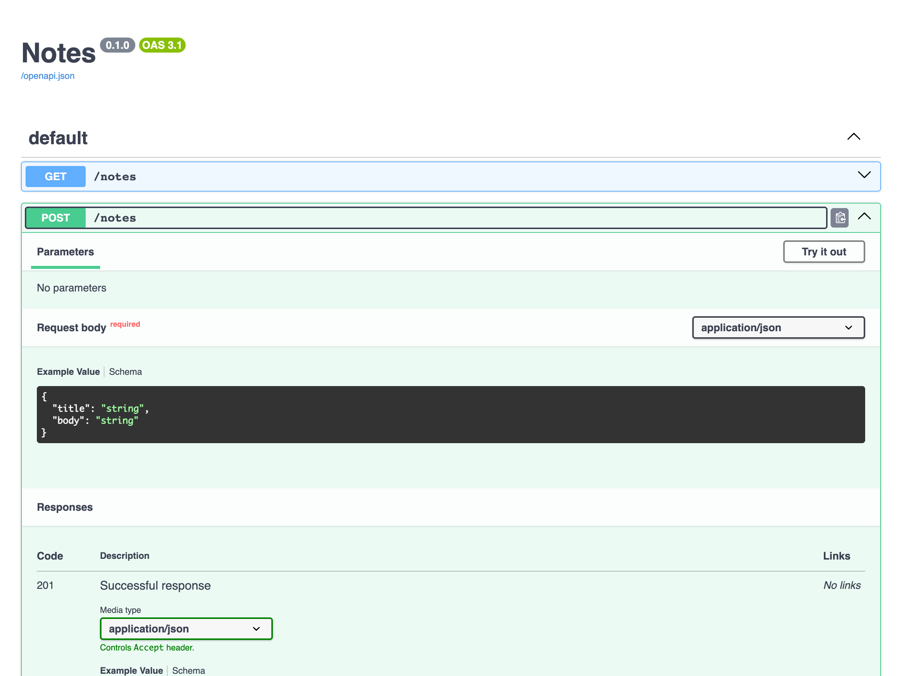
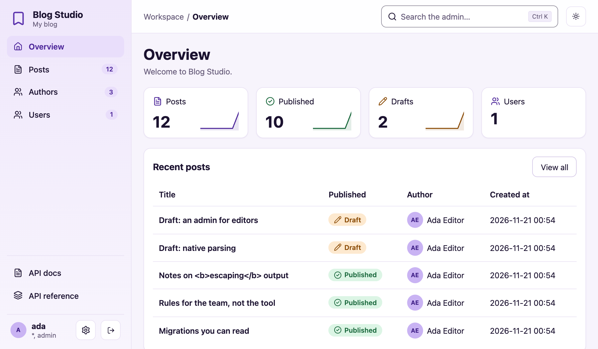

<p align="center">
  <a href="https://hinoki.caspel.dev/">
    <picture>
      <source media="(prefers-color-scheme: dark)" srcset="assets/readme/lockup-dark.svg">
      
    </picture>
  </a>
</p>

<p align="center">
  <strong>Typed Python APIs. Architecture rules you can run.</strong><br>
  <sub>High-throughput Python API framework powered by a Rust HTTP server and SQL ORM. One typed declaration drives routing, validation, OpenAPI, architecture rules, and MCP.</sub>
</p>

<p align="center">
  <a href="https://github.com/caspel26/hinoki/actions/workflows/ci.yml"></a>
  <a href="https://codecov.io/gh/caspel26/hinoki"></a>
  <a href="https://sonarcloud.io/project/overview?id=caspel26_hinoki"></a>
  <a href="https://github.com/caspel26/hinoki/actions/workflows/codeql.yml"></a>
  <a href="https://scorecard.dev/viewer/?uri=github.com/caspel26/hinoki"></a>
  <a href="https://www.bestpractices.dev/projects/16941"></a>
  
  <a href="https://hinoki.caspel.dev/dev/status/"></a>
  <a href="LICENSE"></a>
</p>

<p align="center">
  <a href="https://hinoki.caspel.dev/dev/">Documentation</a> ·
  <a href="https://hinoki.caspel.dev/dev/quick-start/">Quick start</a> ·
  <a href="https://hinoki.caspel.dev/dev/tutorial/">Tutorial</a> ·
  <a href="https://hinoki.caspel.dev/dev/benchmarks/">Benchmarks</a> ·
  <a href="examples/README.md">Examples</a> ·
  <a href="https://hinoki.caspel.dev/dev/status/">Status</a>
</p>

<p align="center">
  <picture>
    <source media="(prefers-reduced-motion: reduce)" srcset="assets/readme/demo.png">
    
  </picture>
</p>
<p align="center"><sub>Real terminal output recorded by <a href="scripts/readme_demo.py"><code>scripts/readme_demo.py</code></a>; waits are shortened, and the posts app's source files and migrations are written off screen.</sub></p>

> [!WARNING]
> **Pre-alpha, not released.** In the planned `0.1.x` line, documented Python, CLI, settings and runtime contracts, plus migration files, stay compatible across patch releases. Additions and fixes for incorrect behavior remain possible and will be described in the changelog. Breaking changes may arrive in a later `0.y.0`; there is no fixed deprecation period and no compatibility promise for undocumented internals or old framework versions. Review migrations and use disposable data when evaluating Hinoki. The package will be named `hinoki-api`; the [`hinoki` package on PyPI](https://pypi.org/project/hinoki/) is an unrelated project.

Hinoki is a high-throughput Python API framework powered by a Rust HTTP server and SQL ORM. Apps run on **Kiso**, Hinoki's own HTTP server, written in Rust on hyper, tokio and rustls. `hinoki dev` and `hinoki serve` run Kiso by default, and `--server granian` runs [Granian](https://github.com/emmett-framework/granian) instead. One typed declaration drives routing, strict schema validation and serialization, OpenAPI, architecture rules, and MCP. You declare schemas, access policies and `atomic` writes in plain Python; `hinoki check` turns architecture rules into findings with a file, a line and a fix. Projects are agent-ready out of the box, with built-in application and development MCP servers and a generated `AGENTS.md`.

<p align="center">
  <a href="#how-it-works">How it works</a> ·
  <a href="#quick-start">Quick start</a> ·
  <a href="#write-an-api">Write an API</a> ·
  <a href="#what-you-get">What you get</a> ·
  <a href="#interactive-api-docs">API docs</a> ·
  <a href="#admin">Admin</a> ·
  <a href="#python-and-rust">Python and Rust</a> ·
  <a href="#status">Status</a>
</p>

## How it works

You declare once. Routing, validation, the OpenAPI document, rules and the development tools read the same declaration; table changes follow a separate, explicit lane.

<p align="center">
  <picture>
    <source media="(prefers-color-scheme: dark)" srcset="assets/readme/arch-dark.svg">
    
  </picture>
</p>

Every request goes through the same steps, in this order. Validation, access and the transaction fail in different ways, so the order is part of the contract ([request lifecycle](docs/request-lifecycle.md)).

<p align="center">
  <picture>
    <source media="(prefers-color-scheme: dark)" srcset="assets/readme/flow-dark.svg">
    
  </picture>
</p>

The router, request parsing and schema validation run in the Rust extension; your handler is plain Python. On an error, an open transaction rolls back before the error response is produced, and every response carries a request ID.

## Quick start

You need [uv](https://docs.astral.sh/uv/) and a stable Rust toolchain; the native extension builds from source.

```sh
git clone https://github.com/caspel26/hinoki && cd hinoki
uv sync --locked
source .venv/bin/activate
hinoki new notes --dir ..   # asks for the database, the server, the rest and a first app
cd ../notes
hinoki dev                  # API docs at http://127.0.0.1:8000/docs
```

The [Quick start](docs/quick-start.md) walks through the prompts.

## Declare and run an app

`hinoki new` writes the application as a module-level `app` in `notes/main.py`, titled after the project:

```python
from hinoki import Hinoki
from hinoki.project import manifest_routes

from notes.settings import ProjectSettings

app = Hinoki(
    settings=ProjectSettings,  # NOTES_* variables and .env
    include=manifest_routes(),  # notes/routes.py, then each app's routes at its prefix
    title="Notes",
    openapi_url="/openapi.json",
    docs_url="/docs",
)  # the rules come from `rules` in hinoki.toml
```

`hinoki.toml` names that application, its routes and its rules, so commands inside the project take no target:

```toml
[project]
application = "notes.main:app"
routes = "notes.routes:routes"
rules = ["notes.rules:project_rules"]
```

A `Hinoki(...)` built in the module `project.application` names reads whatever its arguments leave out from this file: routes, each app's `events`, and the project-wide `middleware` and `rules` lists (`module:attribute` entries you add by hand). So `include=manifest_routes()` above is the explicit form of the default, and the [Tracker example](examples/tracker/hinoki.toml) wires everything from `hinoki.toml` with none of them ([middleware](docs/middleware.md), [rules](docs/rules.md)).

```sh
hinoki dev      # serve on Kiso, reload on changes
hinoki check    # run the project's rules
hinoki routes   # list every route with its access policy
```

## Write an API

The project package holds no models. Answer yes to the last question of `hinoki new` (or pass `--app NAME`), or create an app later; it registers its models, migrations and routes in `hinoki.toml`:

```sh
hinoki app create notes
```

A model, the `Schema` classes that cross the API boundary, and the client filters of a list:

```python
# notes/apps/notes/models.py
from uuid import UUID, uuid4

from hinoki import db
from hinoki.orm import Model, field, pk


@db.table("notes")
class Note(Model):
    id: UUID = pk(default_factory=uuid4)
    title: str = field(max_length=80, index=True)
    body: str = field(max_length=2000, default="")


@db.table("notes_editors")
class Editor(Model):
    id: UUID = pk(default_factory=uuid4)
    token: str = field(unique=True)
```

```python
# notes/apps/notes/schemas.py
from typing import Annotated
from uuid import UUID

from hinoki import Field, Schema, derive
from hinoki.filters import Eq, FilterSet, Search

from notes.apps.notes.models import Note


class NoteIn(Schema):
    title: Annotated[str, Field(min_length=1, max_length=80)]
    body: Annotated[str, Field(max_length=2000)] = ""


@derive(Note, only=("title", "body"), partial=True)
class NotePatch(Schema): ...


class NoteOut(Schema):
    id: UUID
    title: str
    body: str


class NoteStats(Schema):
    total: int


class NoteFilters(FilterSet):
    title: Eq[str]
    search = Search("title", "body")
    ordering = ("title",)
```

An `Access` policy pairs a token check with the permissions it requires ([Authentication](docs/authentication.md)); `crud` generates the actions, applies the policy to each and wraps writes in a transaction:

```python
# notes/apps/notes/security.py
from hinoki import Access, BearerAuth, Caller, Permission

from notes.apps.notes.models import Editor


class NotePermission(Permission):
    WRITE = "notes:write"


class EditorTokens(BearerAuth[Editor]):
    async def resolve_token(self, token: str) -> Caller[Editor] | None:
        editor = await Editor.aget_or_none(token=token)
        if editor is None:
            return None
        return Caller(
            id=str(editor.id), user=editor, permissions={NotePermission.WRITE}
        )


editors = Access(auth=EditorTokens(), permissions=[NotePermission.WRITE])
```

```python
# notes/apps/notes/routes.py
from hinoki import Includable, crud

from notes.apps.notes.api import stats
from notes.apps.notes.models import Note
from notes.apps.notes.schemas import NoteFilters, NoteIn, NoteOut, NotePatch
from notes.apps.notes.security import editors

routes: list[Includable] = [
    crud(
        Note,
        path="",
        read=NoteOut,
        create=NoteIn,
        update=NotePatch,
        delete=True,
        access=editors,
        filters=NoteFilters,
    ),
    stats,
]
```

Anything that is not CRUD is a plain function with an `@http` decorator (`@http.get`, `@http.post`, `@http.put`, `@http.patch`, `@http.delete`), taking the same `access` and `atomic` options:

```python
# notes/apps/notes/api.py
from hinoki import http

from notes.apps.notes.models import Note
from notes.apps.notes.schemas import NoteStats
from notes.apps.notes.security import editors


@http.get("/stats", access=editors)
async def stats() -> NoteStats:
    return NoteStats(total=await Note.all().acount())
```

`routes.py` lists the generated `crud(...)` value and `stats`; `main.py` does not change. The app's routes are mounted at its `prefix`, `/notes` here.

```console
$ hinoki routes
GET     /health           public                    notes.api.health
GET     /notes            EditorTokens[notes:write] notes.apps.notes.routes.NoteCrud.list
POST    /notes            EditorTokens[notes:write] notes.apps.notes.routes.NoteCrud.create
GET     /notes/stats      EditorTokens[notes:write] notes.apps.notes.api.stats
DELETE  /notes/{item_id}  EditorTokens[notes:write] notes.apps.notes.routes.NoteCrud.delete
GET     /notes/{item_id}  EditorTokens[notes:write] notes.apps.notes.routes.NoteCrud.retrieve
PATCH   /notes/{item_id}  EditorTokens[notes:write] notes.apps.notes.routes.NoteCrud.update
```

The list accepts `?title=...`, `?search=...` and `?ordering=title` from the `FilterSet`, and pages by number. Input is validated before the handler runs and a response contains only its declared fields. Tables change only through reviewed SQL: `hinoki migrations plan notes` writes the migration, `hinoki migrations apply` runs it. For several handwritten actions, group the `@http` functions on a `RouteGroup`, which shares a path, an access policy and a transaction across its actions, or use a class-based `API` with `crud` hooks ([function-based APIs](docs/function-endpoints.md), [CRUD](docs/crud.md), [class-based APIs](docs/class-endpoints.md)).

## What you get

| Area | What it gives you |
| --- | --- |
| **Contracts** | `Schema` input and output, access policies, `atomic` writes and declared errors drive validation, the OpenAPI document and the test client. Generated lists take client filters, ordering and search from a `FilterSet`. |
| **Rules** | `hinoki check` has twelve built-in rules: access, permissions, return types, pagination, transactions, model responses, exposed fields, string limits, pinned tables, foreign-key indexes, import direction and, when you list it, email templates that match their context. A new project turns on eight. Each finding names a file, a line and a fix; a waiver needs an owner and a reason. |
| **Data** | SQLite, PostgreSQL, MySQL and MariaDB, explicit relation loading, and SQL migration files you review. Importing an app never connects to a database. |
| **Tools** | Typed settings, generated CRUD, typed events, project-wide middleware, a CLI, MCP servers for the application and for development, `hinoki llms` / `llms.txt` and `AGENTS.md` support for AI agents, and an optional admin. |

## Examples

Three self-contained projects in [`examples/`](examples/README.md), each with its own `hinoki.toml`, tests and a README with a reading order:

* [**Notes**](examples/notes/README.md) (easy): one app, one model and generated CRUD, in five minutes.
* [**Tracker**](examples/tracker/README.md) (medium): several apps with explicit dependencies, access policies, transactions, a filtered list, events, and project-wide middleware and rules.
* [**Blog**](examples/blog/README.md) (complete): tenant, login, admin, MCP, migrations, streaming, events, a rule waiver and metrics.
* [**Mailroom**](examples/mailroom/README.md) (focused): outbound email from templates, an API-key policy and the email-template rule.

## Interactive API docs

With `docs_url="/docs"` (set by `hinoki new`), the app serves interactive API docs generated from the same declarations: paths, request bodies, responses and declared errors. This is the [Notes example](examples/notes/README.md); see the [OpenAPI guide](docs/openapi.md).

<p align="center">
  
</p>

## Admin

The optional admin is mounted explicitly, and installing or importing it never touches a database. See the [admin guide](docs/admin.md).

* **Access:** its own users, a sign-in page and per-model permissions by default; it can use your application's access policy instead.
* **Look:** four themes, each with light and dark modes.
* **Overview:** stat cards and recent records, as in the [Blog example](examples/blog/README.md).

<p align="center">
  <picture>
    <source media="(prefers-color-scheme: dark)" srcset="assets/readme/admin-login-dark.png">
    
  </picture>
  <picture>
    <source media="(prefers-color-scheme: dark)" srcset="assets/readme/admin-overview-dark.png">
    
  </picture>
</p>

## Python and Rust

Kiso is part of the native extension and has no ASGI boundary: eligible routes skip Python routing and binding. Granian runs every request through the ASGI pipeline. Path matching, selected request parsing, schema validation and serialization, and ORM SQL compilation and execution run in the extension. Handlers and most of the request pipeline run in Python; on Kiso, an `async def` handler that only awaits ORM calls is driven from Rust. [Serving](docs/serving.md) and [Kiso](docs/kiso.md) document the boundary.

## Status

Pre-alpha, tested in CI on Linux with Python 3.12–3.14. The [status page](https://hinoki.caspel.dev/dev/status/) lists what is not available yet. The [benchmark report](docs/benchmarks.md) describes retained runs and their limits; it is not a general ranking.

<p align="center">
  <a href="https://hinoki.caspel.dev/dev/guides/">Guides</a> ·
  <a href="https://hinoki.caspel.dev/dev/reference/">Reference</a> ·
  <a href="examples/README.md">Examples</a> ·
  <a href="ROADMAP.md">Roadmap</a> ·
  <a href="CONTRIBUTING.md">Contributing</a> ·
  <a href="LICENSE">MIT license</a>
</p>
