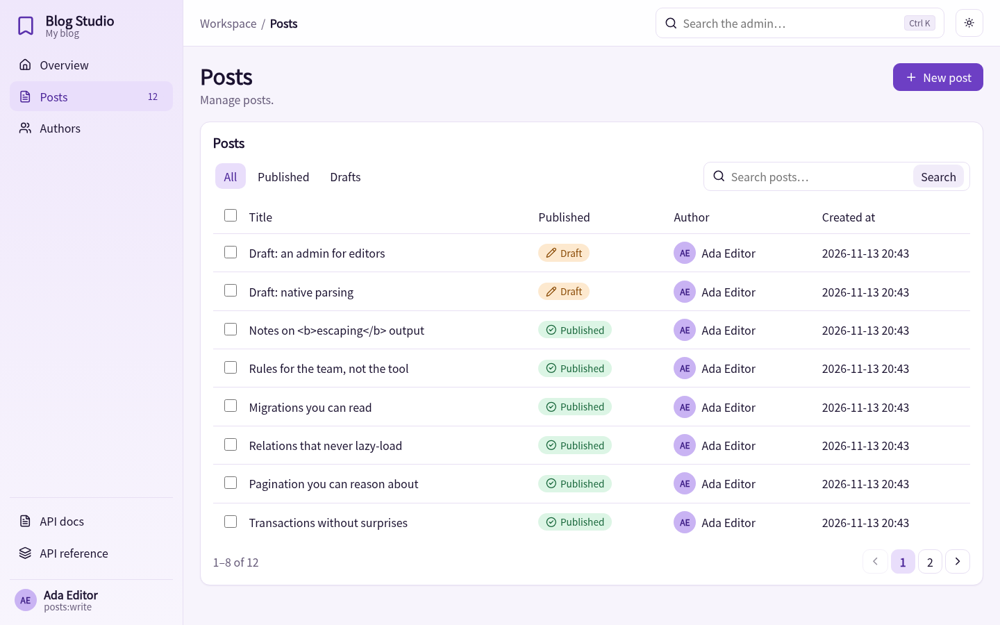
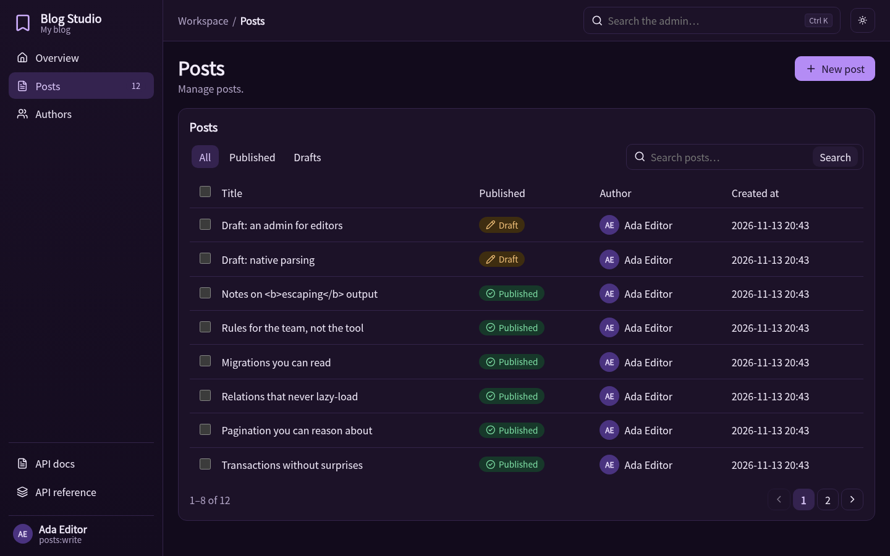
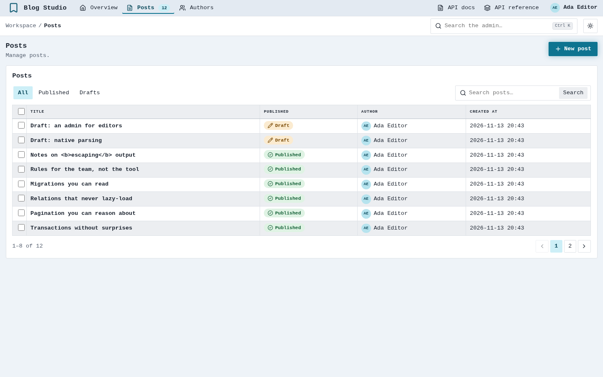
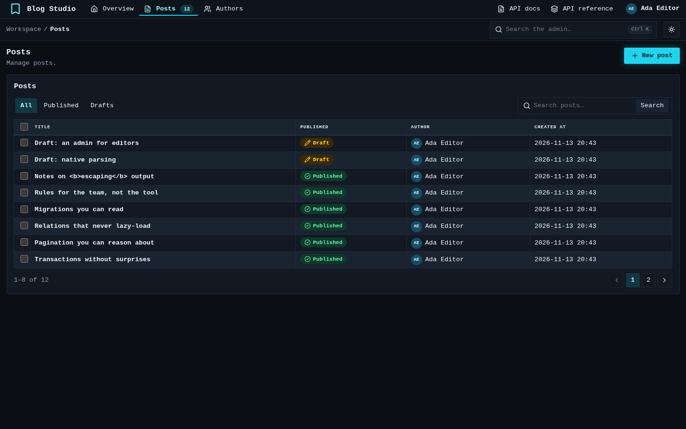
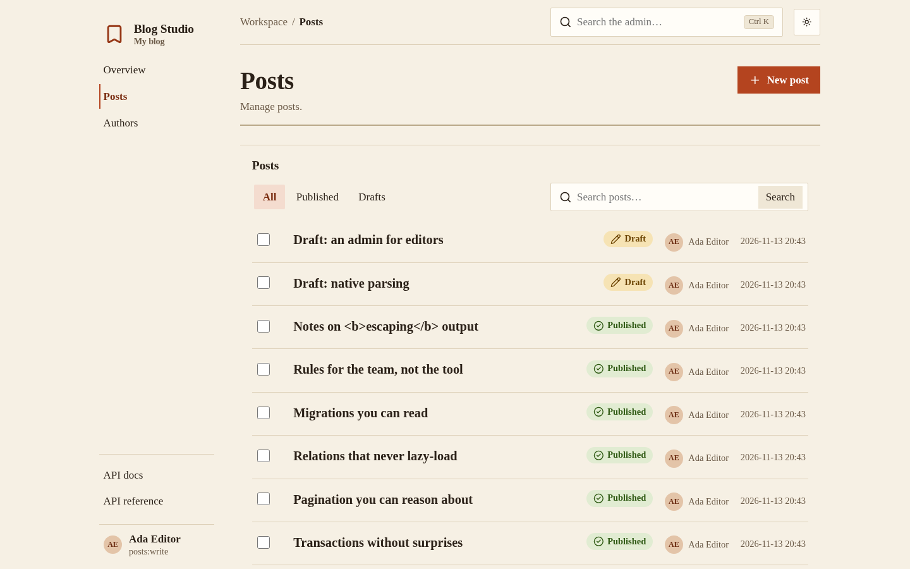
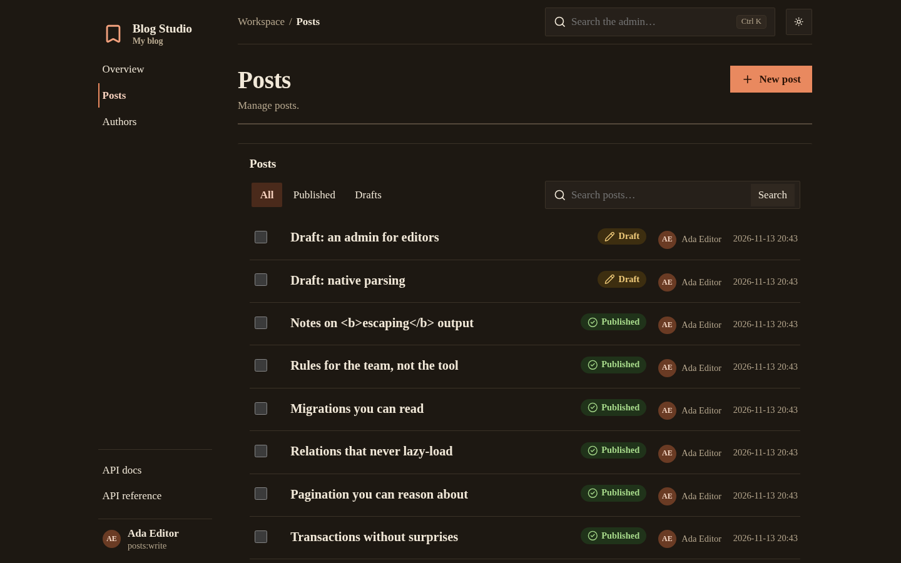

# The admin

An optional extra (`hinoki.admin`) that gives staff a list, search, create, edit, bulk delete and a dashboard for your models, with the same access policies and CSRF protection as the rest of the app. Nothing is mounted unless you ask, and importing it never touches a database.

```python
from hinoki.admin import Admin, ModelAdmin, Badge, Tab, Fieldset

class PostAdmin(ModelAdmin[Post]):
    label = "Posts"
    columns = ("title", "published", "author_id", "created_at")
    search = ("title",)
    ordering = ("-created_at", "-id")
    bulk_delete = True
    readonly = ("created_at",)
    assign = {"author_id": lambda principal: principal.user.id}   # set by the server
    badges = {"published": {True: Badge("Published", "ok"), False: Badge("Draft", "warn")}}
    tabs = (Tab("Published", {"published": True}), Tab("Drafts", {"published": False}))
    fieldsets = (Fieldset("Organization", ("author_id", "published")),)

admin = Admin(access=editors, secret=settings.admin_secret.reveal(),
              prefix="/admin", theme="studio", site="Blog Studio")
admin.register(Post, PostAdmin, slug="posts")
app.include(admin.api())
```

Row visibility, field assignment and which columns are shown are decided in the admin class; hooks (`queryset`, `can`, `display`, `stats`, `check`, `save`, `remove`) override what you need. Mass assignment, excluded columns and out-of-scope rows are refused by the framework, and every form carries a signed CSRF token bound to the signed-in subject.

## Three styles, each with light and dark

A theme is not a colour set: it chooses the navigation, the list presentation, the type and the shape. All three share one set of base components and ship a complete light and dark scheme (the system decides; the toggle overrides it).

| Style | Navigation | List | Edit | Look |
| --- | --- | --- | --- | --- |
| **Studio** (default) | sidebar | cards with a table | drawer beside the list | soft violet, rounded |
| **Console** | horizontal top bar | dense monospaced grid | drawer | neon cyan / teal, square |
| **Paper** | quiet text index, centred column | document rows | its own page | serif type, terracotta |

=== "Studio"

    
    

=== "Console"

    
    

=== "Paper"

    
    

Pick one with `Admin(theme="console")`, or build your own: a `Theme` is a set of `--hn-*` design tokens for the two schemes plus a `layout` (`sidebar`, `topbar`, `index`) and a `list_style` (`table`, `rows`). Every built-in theme is tested for WCAG AA contrast, and the pages were checked in Chromium and Firefox at 1440, 390, 360 and 320 px.
