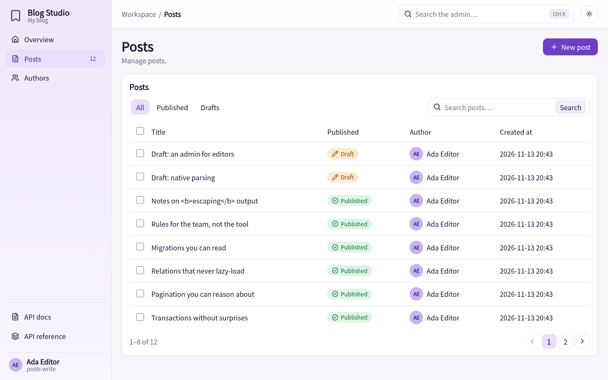
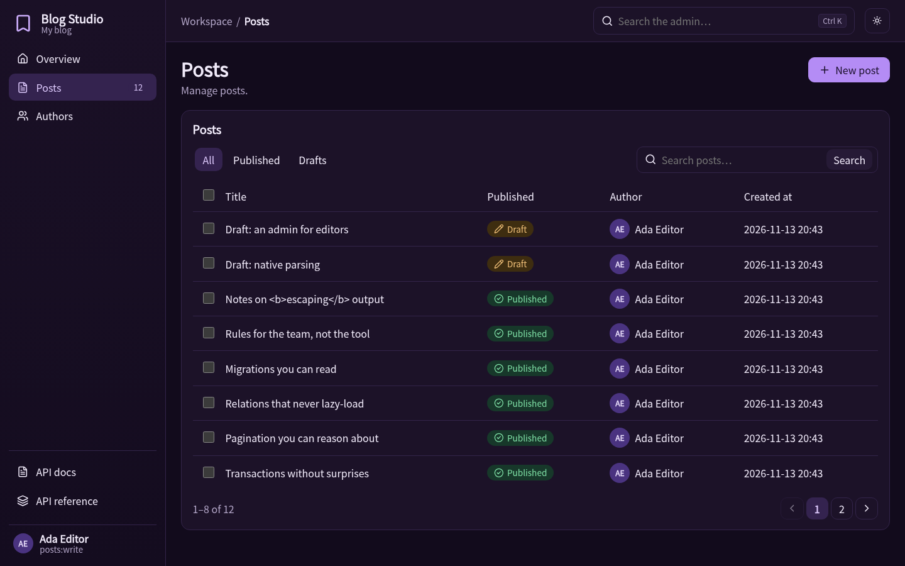
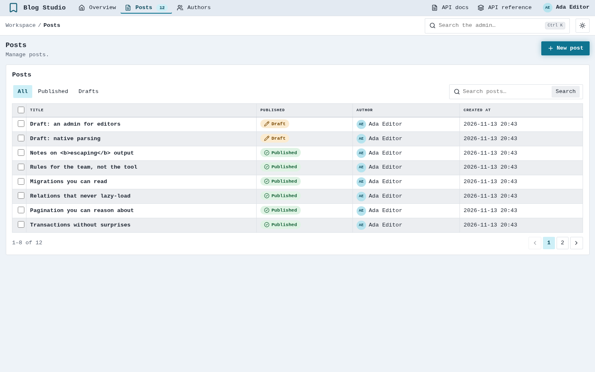
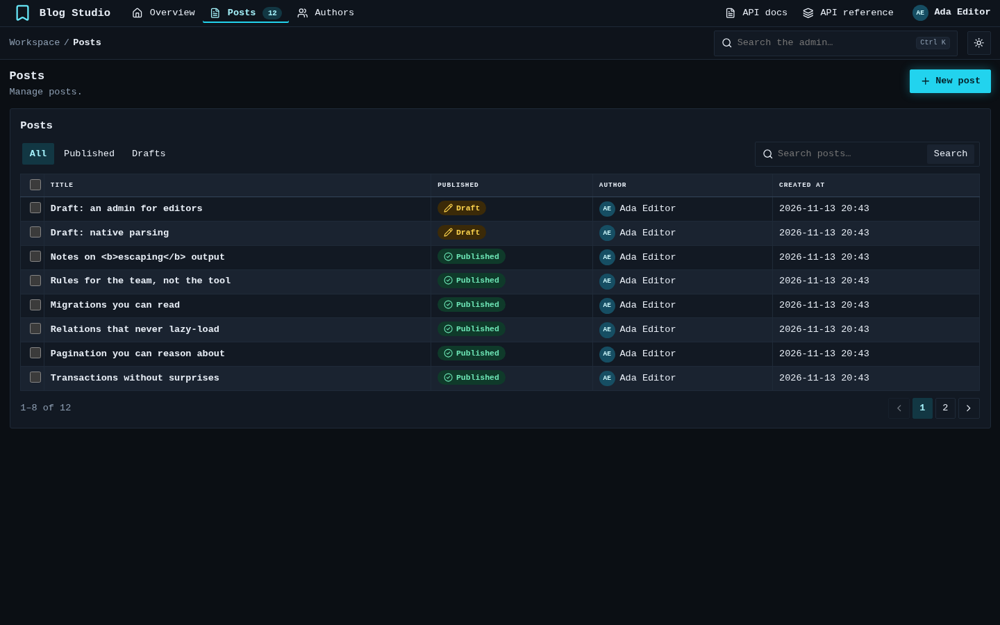
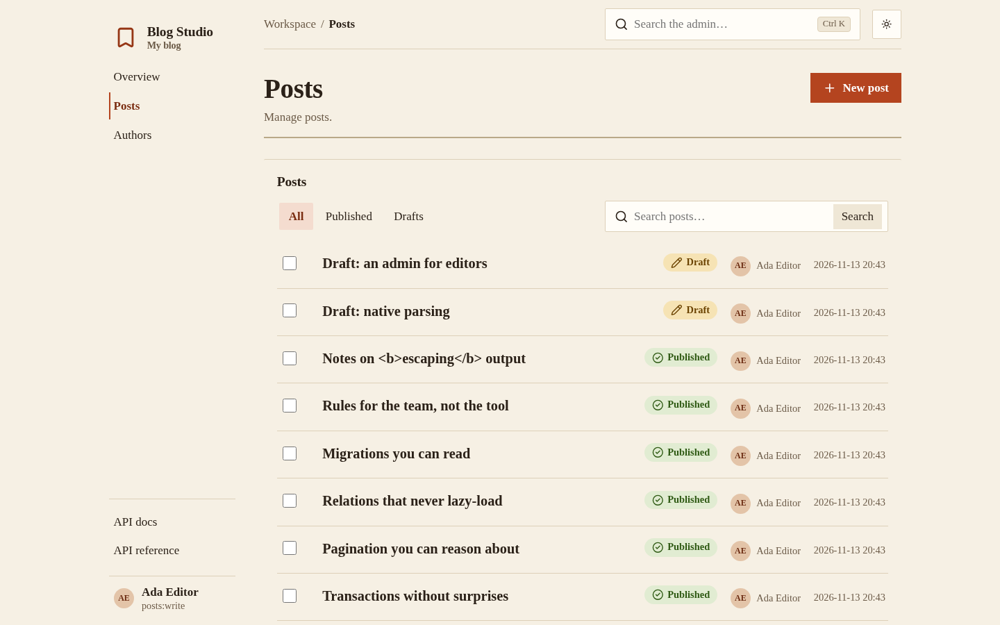
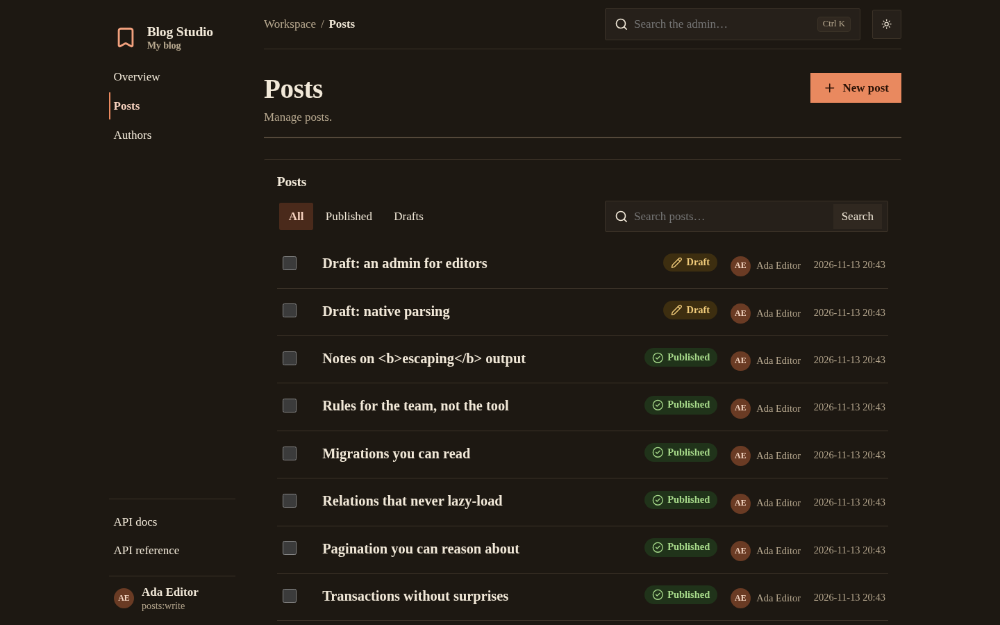
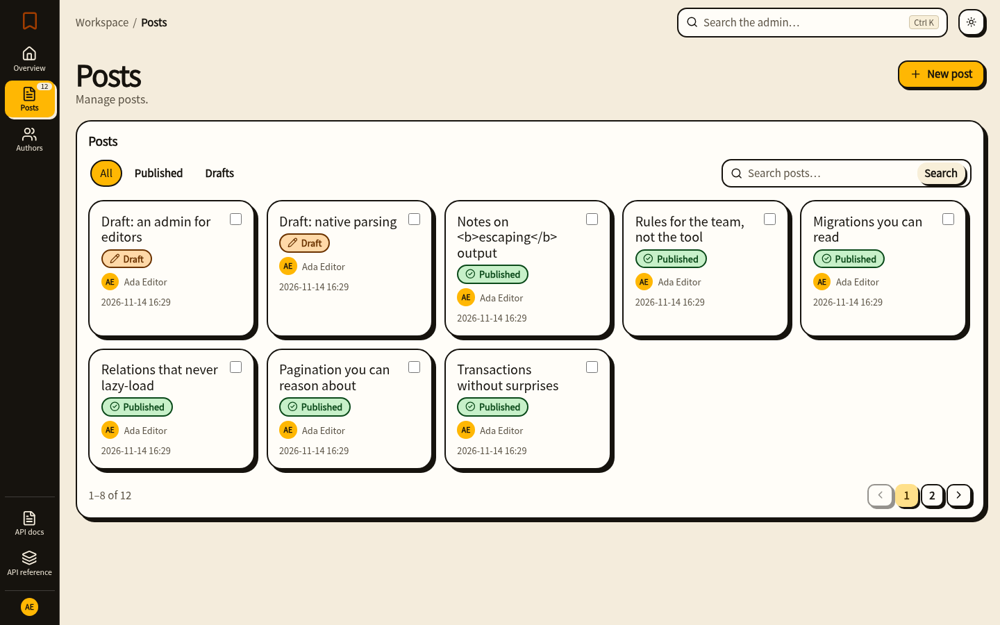
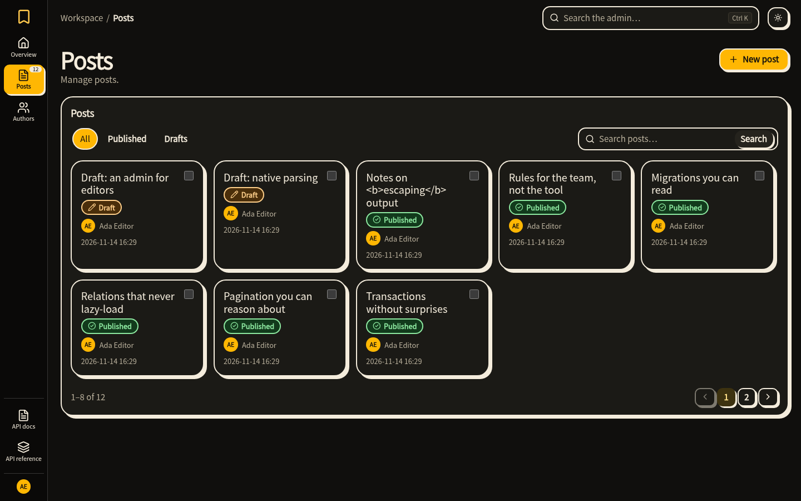
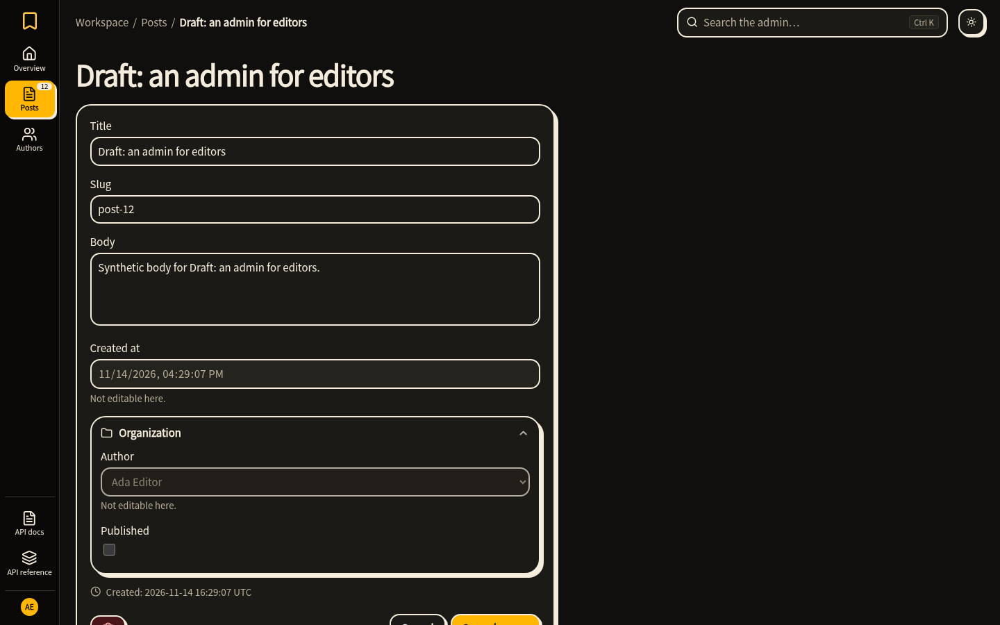
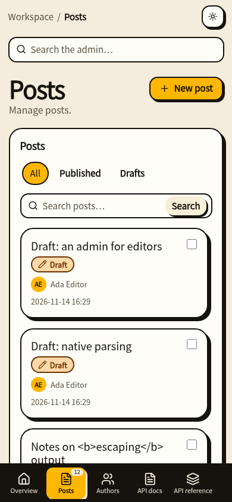

# Customize the admin

A `ModelAdmin` states only what the model does not already say. Class attributes shape the list and the form; methods change behaviour; templates and themes change the look.

```python
# blog/adminsite.py
from hinoki.admin import Admin, ModelAdmin, Tone, action

from blog.models import Post


class PostAdmin(ModelAdmin, model=Post):
    columns = ("title", "published", "author_id", "created_at")
    search = ("title", "slug")
    readonly = ("created_at",)
    badges = {"published": {True: ("Published", Tone.OK), False: ("Draft", Tone.WARN)}}
    tabs = ("published",)  # one tab per badge: Published | Draft
    fieldsets = {"Organization": ("author_id", "published")}

    @action(confirm="Publish the selected posts?")
    async def publish(self, posts, principal):
        await Post.filter(id__in=[p.id for p in posts]).aupdate({"published": True})


site = Admin(site="Blog Studio", per_page=8)
site.register(PostAdmin)
```

## Register a model

`site.register(...)` takes a `ModelAdmin` class, which names its model with `model=`, or a model class, which gets the default admin. It returns what it was given, so `@site.register` works as a class decorator; `@site.admin(Post)` registers a class that need not repeat `model=Post`. The slug in the URL is the table name with dashes (`blog-posts`), or the class attribute `slug = "posts"`.

## Shape the list and the form

| Attribute | Effect | Default |
| --- | --- | --- |
| `columns` | Columns of the list | The model's fields |
| `search` | Columns the search box looks in | The first three text columns the list shows |
| `readonly`, `exclude` | Shown but not editable; never shown | `()` |
| `badges` | Value → `Badge(label, tone, icon)` or `(label, tone[, icon])` | Plain text |
| `tabs` | One tab per badge of the named column | None |
| `fieldsets` | `Fieldset`s, or a dict of title → field names | One group |
| `per_page`, `show_count` | Page size; row count in the sidebar | The site's `Admin(per_page=20, show_count=False)` |
| `bulk_delete` | Offer bulk delete where `can(principal, "delete")` allows | `True` |

`Tone` (`NEUTRAL`, `ACCENT`, `OK`, `WARN`, `DANGER`, `INFO`) is the color role of badges, stats and events. Without configuration the label and plural come from the model, the order from `@db.ordered_by` and the "last modified" line from its `@timestamps` column (`from hinoki.orm import timestamps`).

Search matches a row when any `search` column contains the typed text, compared case-insensitively as text (a number or date matches its printed form). Naming an `exclude`d column in `search` is refused at registration, because which rows match would reveal its value.

Datetime fields use the app's `settings.timezone` (UTC without built-in settings): stored instants are shown there and edited `datetime-local` values are read there, then saved as UTC-aware datetimes. A time that does not exist or occurs twice during a daylight-saving change is refused for correction.

## Override behaviour

Each method below is called by the framework; override what you need and call `super()` for the rest.

```python
# blog/adminsite.py
from hinoki.admin import Avatar, ModelAdmin, Refusal

from blog.models import Post


class PostAdmin(ModelAdmin, model=Post):
    def queryset(self, principal):  # rows this caller sees, in every statement
        return Post.filter(author_id=principal.user.id).select_related("author")

    def can(self, principal, action, row=None):  # narrows a grant, never widens it
        if action == "delete" and row is not None and row.published:
            return False
        return super().can(principal, action, row)

    def display(self, row, column):  # a list cell: text, a Badge or an Avatar
        if column == "author_id":
            return Avatar(row.author.name)
        return super().display(row, column)

    async def check(self, values, principal, row):  # {field: message} refuses
        if values.get("published") and not (values.get("title") or (row and row.title)):
            return {"title": "A published post needs a title."}
        return {}

    async def remove(self, row, principal):
        if row.published:
            raise Refusal("Unpublish the post first.")  # shown on the page
        await super().remove(row, principal)
```

* `queryset(principal)` decides which rows a caller sees; counts and pages come from it. `can(principal, "view", row)` then trims the fetched page, so a page may hold fewer rows than `per_page`.
* `save(values, principal, row=None)` and `remove(row, principal)` are the only places that write; run a domain operation there instead of a raw write. `Refusal` raised in either rolls the write back and shows its message.
* `stats(principal)` returns the dashboard `Stat`s for the model.
* Mass assignment, excluded columns and out-of-scope rows are refused by the framework.

## Add fields that are not columns

`extra_fields` (or an `extras()` method, when the choices depend on what is registered) adds form fields that are not columns:

* `Extra("password", "Password", "password")`: a masked input, never filled in again.
* `Extra("tags", "Tags", "choices", choices=(("a", "A"), ("b", "B")))`: checkboxes; the value is a `frozenset` of the checked ones.

They reach `check` and `save` next to the columns, so `save` takes them out before writing the row; `extra_initial(row)` returns what the edit form shows. The Users section is built this way (`hinoki.admin.users.useradmin`).

## Add a bulk action

Mark an async method with `@action`. The list shows the button once rows are selected:

```python
# blog/adminsite.py
from typing import Any

from hinoki import Caller
from hinoki.admin import ModelAdmin, action

from blog.models import Post


class PostAdmin(ModelAdmin, model=Post):
    @action(confirm="Publish the selected posts?")
    async def publish(self, posts: tuple[Post, ...], principal: Caller[Any]) -> None:
        ids = [post.id for post in posts]
        await Post.filter(id__in=ids).aupdate({"published": True})
```

* The action name is the method name with `_` written as `-`; the label defaults to "Publish selected". `view`, `add`, `change` and `delete` are reserved.
* The name is also the permission checked by `can(principal, name, row)`. Every selected row is checked against the queryset and `can` before confirmation and again before execution; one denied row refuses the whole action.
* The action runs in the admin's write transaction with the selected rows locked, on at most 200 distinct rows (more answer `400`). A failure rolls everything back; success redirects to the list with a notice.
* Handlers still apply their own domain conditions to writes that involve related records or external state.

## Replace the HTML or the stylesheet

`Admin(templates="admin_ui")` reads `admin_ui/components/NAME.html` before the built-in component of the same name (`shell`, `sidebar`, `table`, `form`, `field`, `auth` for the sign-in page, ...) and appends `admin_ui/admin.css` after the theme. Copy the built-in component from the package as a starting point; keep its `{{ value }}` (escaped) and `{{{ raw }}}` placeholders.

```css
/* admin_ui/admin.css */
.hn-auth-card { border-radius: 0; }
.hn-nav-item[aria-current="page"] { font-weight: 800; }
```

## Choose or build a theme

Four built-in styles, each with light and dark modes; the system preference picks the initial mode and the toggle overrides it. Pick one with `Admin(theme="bento")`.

| Style | Navigation | List | Edit | Look |
| --- | --- | --- | --- | --- |
| **Studio** (default) | Sidebar | Cards with a table | Drawer beside the list | Soft violet, rounded |
| **Console** | Top bar | Dense monospaced grid | Drawer | Neon cyan and teal, square |
| **Paper** | Quiet text index, centred column | Document rows | Own page | Serif type, terracotta |
| **Bento** | Icon rail (bottom tab bar on phones) | Grid of cards | Own page | Ink outlines, offset shadows, yellow accent |

=== "Studio"

    
    

=== "Console"

    
    

=== "Paper"

    
    

=== "Bento"

    
    
    
    

A `Theme` is a set of `--hn-*` design tokens for both schemes, plus `edit` (`"drawer"`, `"page"`), `layout` (`"sidebar"`, `"topbar"`, `"index"`, `"rail"`) and `list_style` (`"table"`, `"rows"`, `"cards"`). Start from a built-in one:

```python
# blog/adminsite.py
import dataclasses

from hinoki.admin import THEMES, Admin

studio = THEMES["studio"]
forest = dataclasses.replace(
    studio,
    name="forest",
    label="Forest",
    light={**studio.light, "accent": "#1f6f50", "accent-hover": "#17543c"},
    dark={**studio.dark, "accent": "#5cc79b", "accent-hover": "#7ad6b0"},
    layout="topbar",
    extra_css=".hn-brand-text strong { letter-spacing: .04em; }",
)
site = Admin(theme=forest)
```

`extra_css` is appended after the tokens; `default_mode="dark"` starts dark until the user switches. The text and surface colour pairs of the built-in themes are tested against WCAG AA contrast. Bento was checked in Chromium and Firefox at 1440, 390, 360 and 320 px; WebKit was not run.

## Errors and edge cases

All of these fail when the `Admin` is created or the model registered, not on a request:

| Mistake | Error |
| --- | --- |
| A `ModelAdmin` naming a different model than the one registered | `RegistrationError` |
| `search` naming an `exclude`d column | `RegistrationError` |
| A bulk action named `view`, `add`, `change` or `delete` | `RegistrationError` |
| A template file that is not a component, an unknown placeholder, `{{ }}` changed to `{{{ }}}`, or a `form`, `table`, `confirm` or `auth` override without `{{ csrf }}` | `TemplateError` |
| A theme with a missing token, unknown layout or bad name | `ValueError` from the `Theme`, before any page is served |

## See also

* [Add an admin](admin.md)
* [Define models](models.md)
* [Admin API reference](reference/admin.md)
