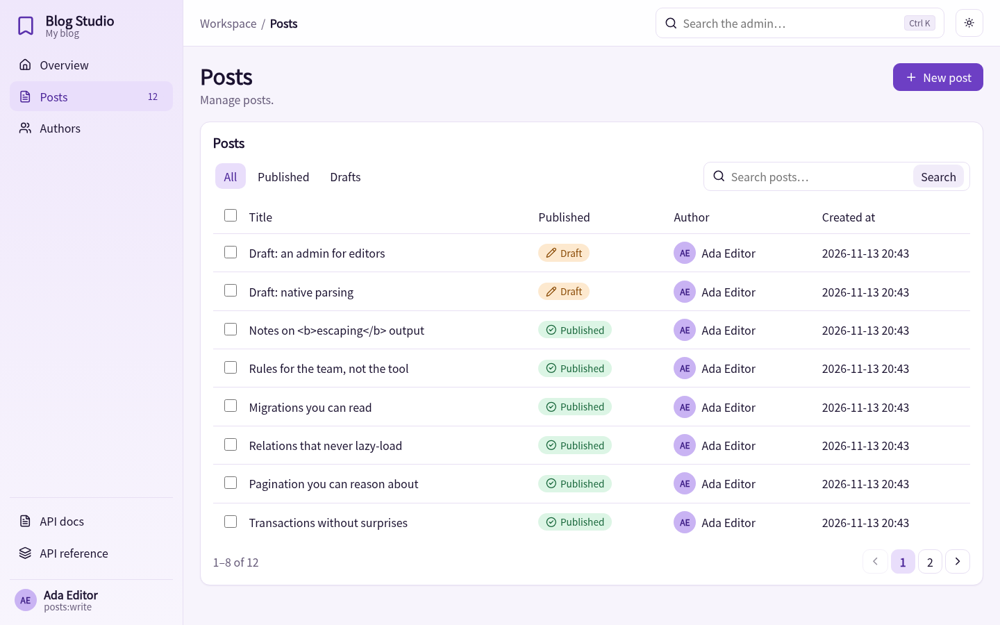
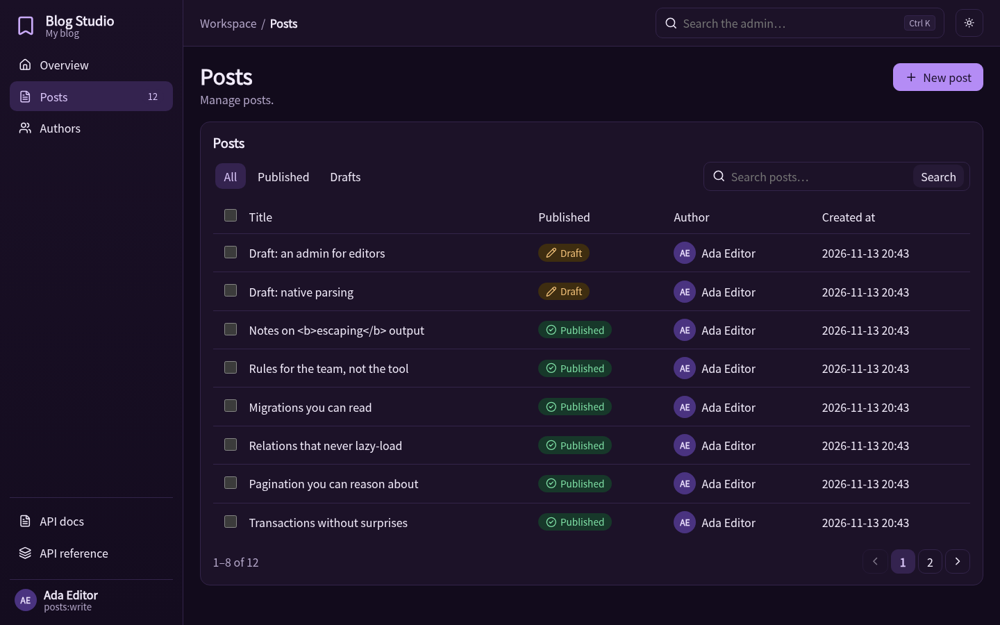
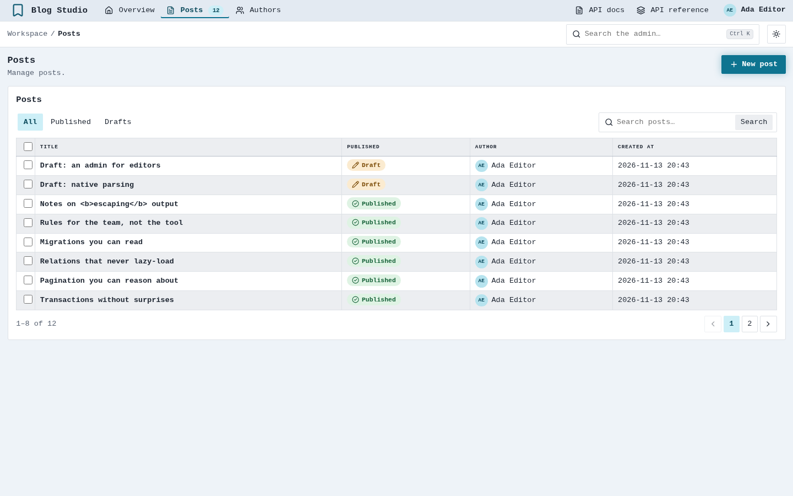
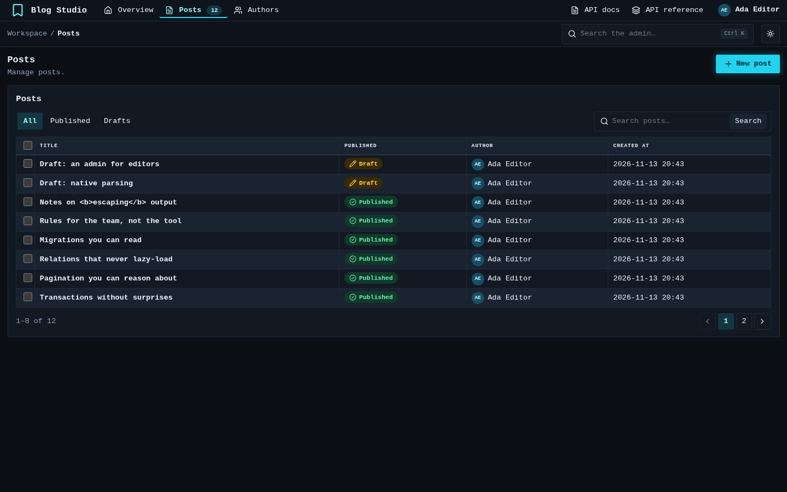
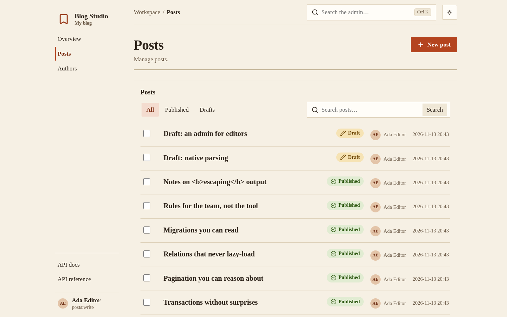
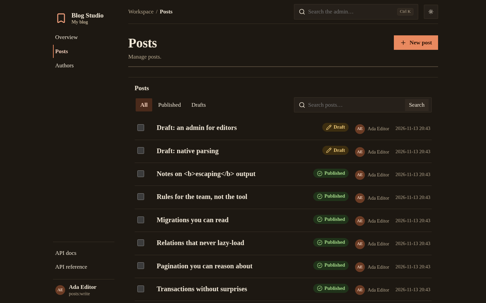
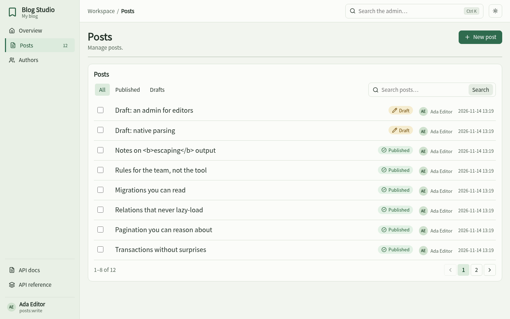
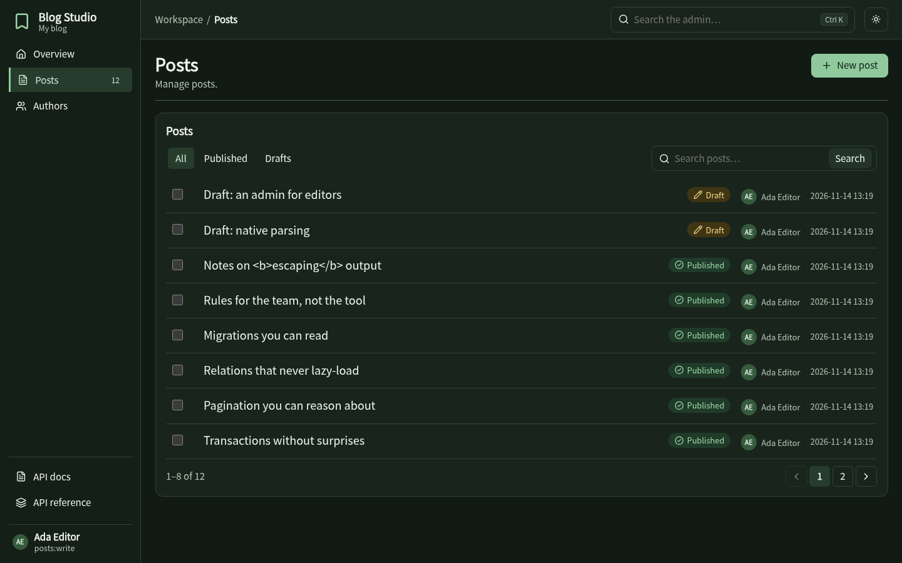
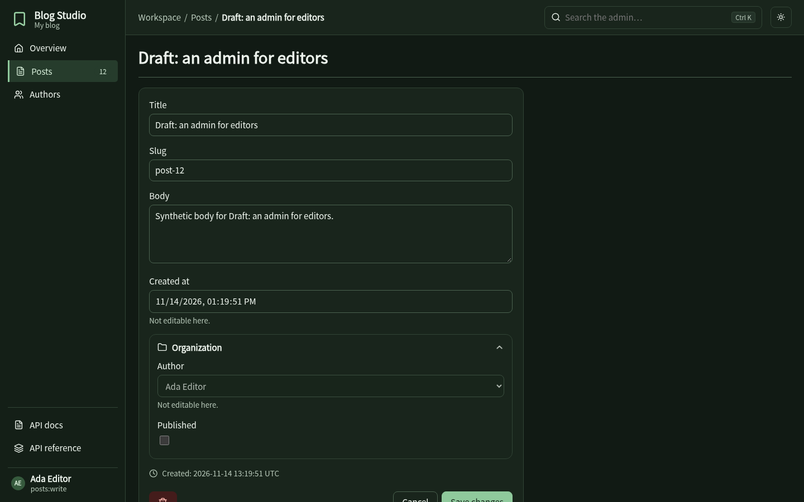

# The admin

An optional extra (`hinoki.admin`) that gives staff a list, search, create, edit, bulk delete and a dashboard for your models, with the same access policies and CSRF protection as the rest of the app. Nothing is mounted unless you ask, and importing it never touches a database.

```python
from hinoki.admin import Admin, ModelAdmin, Badge, Tab, Fieldset

class PostAdmin(ModelAdmin[Post]):
    label = "Posts"
    columns = ("title", "published", "author_id", "created_at")
    search = ("title",)
    ordering = ("-created_at", "-id")
    bulk_delete = True
    readonly = ("created_at",)
    assign = {"author_id": lambda principal: principal.user.id}   # set by the server
    badges = {"published": {True: Badge("Published", "ok"), False: Badge("Draft", "warn")}}
    tabs = (Tab("Published", {"published": True}), Tab("Drafts", {"published": False}))
    fieldsets = (Fieldset("Organization", ("author_id", "published")),)

admin = Admin(access=editors, secret=settings.admin_secret.reveal(),
              prefix="/admin", theme="studio", site="Blog Studio")
admin.register(Post, PostAdmin, slug="posts")
app.include(admin.api())
```

Row visibility, field assignment and which columns are shown are decided in the admin class; hooks (`queryset`, `can`, `display`, `stats`, `check`, `save`, `remove`) override what you need. Mass assignment, excluded columns and out-of-scope rows are refused by the framework, and every form carries a signed CSRF token bound to the signed-in subject.

## Bulk actions

Add an async handler and declare it with `BulkAction` on the model admin. The list shows its action button after rows are selected:

```python
from typing import Any

from hinoki import Caller
from hinoki.admin import BulkAction, ModelAdmin


async def publish(posts: tuple[Post, ...], _principal: Caller[Any]) -> None:
    await Post.filter(id__in=[post.id for post in posts]).aupdate(
        {"published": True}
    )


class PostAdmin(ModelAdmin[Post]):
    bulk_actions = (
        BulkAction(
            name="publish",
            label="Publish selected",
            confirm="Publish the selected posts?",
            handler=publish,
        ),
    )
```

The action name is also the permission checked by `ModelAdmin.can(principal, name, row)`. Hinoki checks model access before showing the button and checks every selected row against the scoped queryset and row permission both before confirmation and before execution. The confirmation includes the selected row count. If any selected row is unavailable or denied, the whole action is refused. The handler receives only the selected rows and the caller. During execution, Hinoki locks the selected model rows until the action transaction finishes, so another transaction cannot change their row-level authorization fields between the check and the handler's writes. Handlers should still apply their domain conditions to writes, especially when those conditions involve related records or external state.

Each action requires confirmation and runs inside the admin write transaction. A failure rolls back the selected work; successful actions redirect to the list with a notice. Actions accept at most 200 distinct rows. `bulk_delete = True` adds the built-in delete action.

## Four styles, each with light and dark

Each theme sets navigation, list presentation, typography and color. All four use the same components and provide light and dark modes; the system preference selects the initial mode, and the toggle overrides it.

| Style | Navigation | List | Edit | Look |
| --- | --- | --- | --- | --- |
| **Studio** (default) | sidebar | cards with a table | drawer beside the list | soft violet, rounded |
| **Console** | horizontal top bar | dense monospaced grid | drawer | neon cyan / teal, square |
| **Paper** | quiet text index, centred column | document rows | its own page | serif type, terracotta |
| **Grove** | sidebar | open rows | its own page | evergreen and lichen, sans-serif |

=== "Studio"

    
    

=== "Console"

    
    

=== "Paper"

    
    

=== "Grove"

    
    
    

Pick one with `Admin(theme="grove")`, or build your own: a `Theme` is a set of `--hn-*` design tokens for the two schemes plus a `layout` (`sidebar`, `topbar`, `index`) and a `list_style` (`table`, `rows`). The text and surface colour pairs of every built-in theme are tested against WCAG AA contrast. Grove's pages were checked in Chromium and Firefox at 1440, 390, 360 and 320 px; WebKit was not run.
