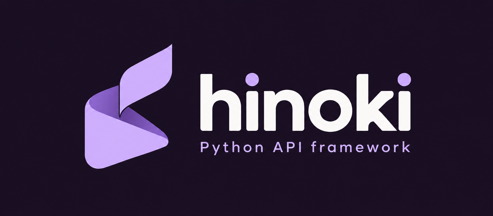

# Hinoki { .hn-hidden }

<div class="hn-hero" markdown>

<div class="hn-hero-copy" markdown>

<p class="hn-kicker">Typed Python · checked architecture</p>

<h2 class="hn-title">Write the promise.<br>Check that it holds.</h2>

<p class="tag">Access, transactions and errors live beside the endpoint. Rules check the architecture at startup and in your build. Development tools read the same contracts as the app.</p>

```sh
uv sync --locked
uv run hinoki check app.main:app
```

[Get started](getting-started.md){ .md-button .md-button--primary }
[Take the tutorial](tutorial/index.md){ .md-button }

</div>

<div class="hn-hero-art">
  
  <div class="hn-rings" aria-hidden="true"></div>
  <p>Python you can read.<br>Architecture you can verify.</p>
</div>

</div>

!!! warning "Pre-alpha"
    Not published to PyPI and the API will change. A reference blog and a layered tracker run end to end on PostgreSQL. [What works today](https://github.com/caspel26/hinoki#what-works-today).

## One feature, from model to checked API

=== "models.py"

    ```python
    @indexed("owner_id", "created_at")
    @ordered_by("-created_at")
    class Task(Model, table="tasks"):
        id: UUID = field(primary_key=True, default_factory=uuid4)
        owner_id: UUID = foreign_key(Member, on_delete="restrict", related_name="tasks")
        title: str = field(max_length=120)
        done: bool = False
    ```

=== "schemas.py"

    ```python
    class TaskIn(Schema):
        title: Annotated[str, Field(min_length=1, max_length=120)]

    class TaskOut(Schema, model=Task, exclude=["owner_id"]):
        ...
    ```

=== "api.py"

    ```python
    tasks = Endpoints("/tasks", access=member_only, atomic=True)

    @tasks.post("/{task_id}/complete", errors=(NotFound, TaskAlreadyDone))
    async def complete(task_id: UUID, caller: Caller[Member]) -> TaskOut:
        return TaskOut.from_model(await operations.complete_task(caller.user.id, task_id))
    ```

=== "hinoki check"

    ```text
    $ hinoki check tracker.app:create_app --rules tracker.rules:rules
    tracker/api.py:41: HNK-ACC-001 [violated] DELETE /tasks/{task_id} (delete_task) declares no access policy
    tracker/api.py:41: HNK-TXN-001 [violated] DELETE /tasks/{task_id} (delete_task) does not declare transaction=True
    2 rule(s): 2 violated, 0 unverifiable, 0 waived
    ```

<div class="hn-grid" markdown>

<div class="hn-card" markdown>
### Rules, not conventions
`access`, `transaction`, response shapes and import direction are checked: at startup and from `hinoki check`. Waivers need a reason and an owner, and tools cannot write them. [Rules](RULES.md)
</div>

<div class="hn-card" markdown>
### Declared errors
`errors=(NotFound, TaskAlreadyDone)` gives each action its failures once. OpenAPI, MCP tool descriptions and the strict test client all read it. [Patterns](PATTERNS.md)
</div>

<div class="hn-card" markdown>
### Native where it counts
Parsing, strict validation, JSON, Argon2id, JWT and the SQL compiler run in Rust; the surface is plain typed Python, [sync or async](SYNC-ASYNC.md). [Parsers and renderers](CODECS.md)
</div>

<div class="hn-card" markdown>
### Development tools
`hinoki new` writes project conventions; `hinoki check` reports rule violations; MCP tools expose the same application contracts. [Tooling guide](AI-WORKFLOW.md)
</div>

<div class="hn-card" markdown>
### Typed settings, quiet secrets
Immutable settings from the environment, `*_FILE` secrets, `Secret` values that never print, and a command that shows where every value came from. [Settings](SETTINGS.md)
</div>

<div class="hn-card" markdown>
### An admin with three styles
Studio, Console and Paper: different navigation, lists and type, each in light and dark, CSRF-safe and contrast-tested. [The admin](ADMIN.md)
</div>

</div>

## Pick your path

<div class="hn-grid" markdown>

<div class="hn-card" markdown>
### Start
Install, create a project, run an API in five minutes. [Getting started](getting-started.md)
</div>

<div class="hn-card" markdown>
### Build
A six-step tutorial: models, schemas, operations, endpoints, rules, serving. [Tutorial](tutorial/index.md)
</div>

<div class="hn-card" markdown>
### Understand
Why it is built this way: layers, sync and async, the request lifecycle, decisions. [Patterns](PATTERNS.md)
</div>

<div class="hn-card" markdown>
### Look up
Every public class, generated from the code. [API reference](reference/index.md)
</div>

</div>
